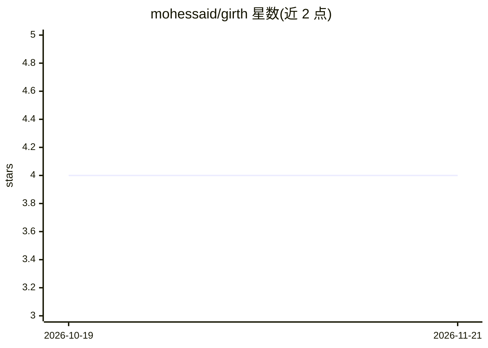

# mohessaid/girth

⭐ 4 · Rust · MIT · 推送 2026-11-18 · [GitHub](https://github.com/mohessaid/girth) · 个人维护

**为 agent 项目按需蒸馏精简技能，降低常驻技能 token 开销**

Girth 是一个 Rust 编写的 CLI 与 Agent Skills 技能：任务进行时按需从已安装技能中蒸馏出项目所需片段，生成为 ≤3 KB 的 `girth-<domain>` 技能并缓存复用，以替代每轮加载全部大体积技能。它按 Agent Skills 开放规范输出，可被多个 harness 读取；另提供技能搜索、show、fetch、用量统计与跨 harness 的花费导入。通过 Claude Code 插件、Codex 插件、Gemini/Antigravity 扩展或 skills CLI 安装，首个运行时下载预编译二进制，无需 Rust。

## 筛选速览

| 维度 | 判定 | 备注 |
|---|---|---|
| AI 角色 | `ai-ecosystem` | LLM/agent 周边工具 |
| 许可风险 | `permissive` | MIT |
| 部署形态 | `library` | 以包/库形式分发 |
| 模型依赖 | — | README 未给出锁定关系 |
| 硬件要求 | — | 无带数字的原话,不猜 |
| 安装摩擦 | `medium` | 含编译或系统依赖之一 |
| 成熟度 | `idea` | |

## 能力要点

- 按任务蒸馏项目专属小技能，常驻成本较 39 个全量技能降低 38×（README 自报数据）
- 遵循 Anthropic 捐赠的 Agent Skills 开放规范，输出可被 70+ 平台读取
- 支持 79+ harness 的技能发现与 `.agents/skills`/`.claude/skills` 双目录写入
- girth import 读取 Codex/Copilot/OpenCode 等本地会话日志核算花费

## 适用场景

- 减少 agent 每轮加载几十个技能的 token 开销
- 在多个 harness 间共享同一套项目技能缓存
- 统计各 agent CLI 的实际模型花费并给出优化建议

## 场景标签

`提示工程` · 领域:Agent 开发

## 证据(README 行号)

> L5: **Just-in-time, project-scoped agent skills.**
> L130: Girth's core is a plain binary and an Agent Skills skill, so it is not tied to Claude Code:
> L167: 4. The model distils only that slice into `<output_dir>/girth-<domain>/SKILL.md`: `.claude/skills` under Claude Co

## 星数曲线

2026-10-19 4 → 2026-11-21 4（+0）

---
*卡片 v1 · prompt 1.4 · 生成 2026-11-21 · 置信度 high · 依据 README sha `6b354a13f1b1` · [字段定义](../../DATASET.md)*
