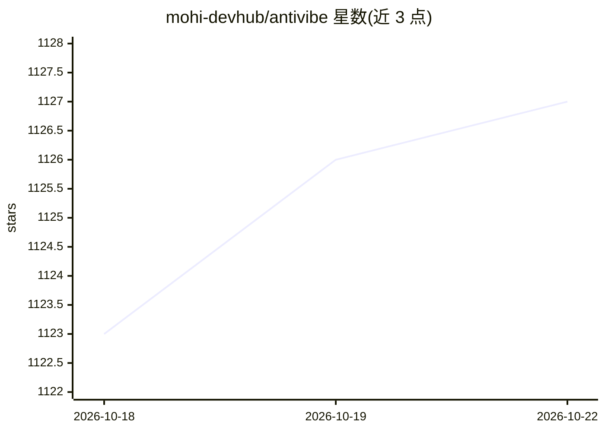

# mohi-devhub/antivibe

⭐ 1,128 · Shell · MIT · 推送 2026-07-31 · [GitHub](https://github.com/mohi-devhub/antivibe) · 个人维护

**把 AI 生成的代码转成教学式深度解读的 Claude Code 技能**

面向使用 Claude Code 的开发者的技能（skill）：对任意文件、目录或模块——新代码、遗留代码或 AI 生成代码——生成教学式深度解读或资深级架构审计，无需 git 历史或 AI 作者标记。支持 junior/mid/senior 三档讲解深度，compact/full 两种输出模式，known_concepts 跳过表可压缩篇幅，输出保存为 markdown 文件；可选 hooks 在任务结束后自动生成。安装方式为 git clone 后复制到 ~/.claude/skills/。

## 筛选速览

| 维度 | 判定 | 备注 |
|---|---|---|
| AI 角色 | `ai-native` | 本体是模型或模型工具 |
| 许可风险 | `permissive` | MIT |
| 部署形态 | `None` |  |
| 模型依赖 | locked-api |  |
| 硬件要求 | — | 无带数字的原话,不猜 |
| 安装摩擦 | `low` | 无编译、无系统依赖或容器化 |
| 成熟度 | — | 结构信号不足 |

## 能力要点

- 对任意代码生成深度学习指南或架构审计
- junior/mid/senior 三档深度与 compact/full 输出模式
- known_concepts 已知概念跳过表与前置知识映射
- SubagentStop/Stop 钩子自动生成解读

## 适用场景

- 我 copy-paste 了 AI 写的代码，想真正弄懂它的设计决策
- 接手遗留代码库时生成系统性的讲解材料
- 对已有代码做资深视角的取舍与可测试性审计

## 场景标签

`代码审查` · 领域:编码与开发

## 证据(README 行号)

> L9:  A code learning &amp; audit framework for Claude Code that turns any codebase — new, legacy, or AI-generated — into
> L55: /antivibe                        # Start a deep dive (compact, mid-level by default)

## 星数曲线

2026-10-18 1,123 → 2026-10-22 1,127（+4）

---
*卡片 v1 · prompt 1.4 · 生成 2026-10-21 · 置信度 high · 依据 README sha `0e6caaf4025b` · [字段定义](../../DATASET.md)*
