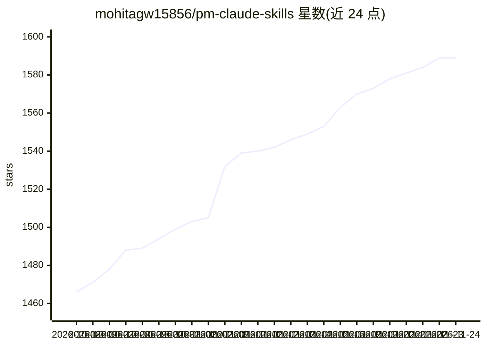

# mohitagw15856/pm-claude-skills

⭐ 1,595 · JavaScript · MIT · 推送 2026-11-23 · [GitHub](https://github.com/mohitagw15856/pm-claude-skills) · [官网](https://mohitagw15856.github.io/pm-claude-skills/) · 个人维护 · 中文 README

**面向 AI 助手的职业任务技能库：1,374 个 markdown 技能**

开源的 Agent Skills 库，以纯 markdown SKILL.md 文件提供 1,374 个职业技能，每个技能包含工作框架、输出模板、质量检查与反模式清单，覆盖产品管理、工程、求职、考试、创业及中文职场场景。通过 npx 安装器、Claude Code 插件市场、MCP 服务器或 REST API 分发到 Claude、ChatGPT、Gemini、Cursor、Codex 等工具；21 个技能面向 Claude Duet 类常驻 agent 设计，带审批门与注入演练沙箱。MIT 许可，收录在 Anthropic 官方插件目录。

## 筛选速览

| 维度 | 判定 | 备注 |
|---|---|---|
| AI 角色 | `ai-knowledge` | 知识聚合/清单类 |
| 许可风险 | `permissive` | MIT |
| 部署形态 | `library` | 以包/库形式分发 |
| 模型依赖 | — | README 未给出锁定关系 |
| 硬件要求 | — | 无带数字的原话,不猜 |
| 安装摩擦 | `low` | 无编译、无系统依赖或容器化 |
| 成熟度 | — | 结构信号不足 |

## 能力要点

- 1,374 个 SKILL.md 技能，含框架、模板、质量检查与反模式
- 分发方式覆盖 npx 安装器、MCP 服务器、REST API 与离线包
- 73 个技能有简体中文版，16 个中文场景技能包
- 21 个面向常驻 agent（Claude Duet）的技能，带审批门与注入演练

## 适用场景

- 让 AI 助手按资深产品经理标准产出 PRD 与风险清单
- 解读租约、账单、劳动合同等文件的具体条款与金额
- 用中文让 AI 写周报、模拟公务员面试、计算裁员补偿

## 场景标签

`提示工程` · 领域:Agent 开发

## 证据(README 行号)

> L51: PM Skills is an open-source library of 1374 Agent Skills — plain-markdown SKILL.md files that teach an AI assistant
> L112: A skill is one plain-markdown SKILL.md file: a description that tells your assistant when to load it, plus the wor

## 星数曲线

2026-10-18 1,466 → 2026-11-24 1,589（+123）

---
*卡片 v1 · prompt 1.4 · 生成 2026-11-23 · 置信度 high · 依据 README sha `59982f12cb0e` · [字段定义](../../DATASET.md)*
