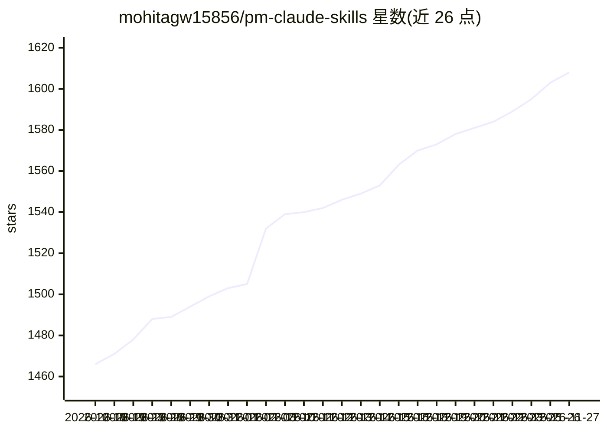

# mohitagw15856/pm-claude-skills

⭐ 1,608 · JavaScript · MIT · 推送 2026-11-26 · [GitHub](https://github.com/mohitagw15856/pm-claude-skills) · [官网](https://mohitagw15856.github.io/pm-claude-skills/) · 个人维护 · 中文 README

**面向 Claude/ChatGPT 等助手的专业 Agent 技能 markdown 库**

开源的 1,390 个 Agent Skills 库，每个技能是一个 SKILL.md 纯 markdown 文件，内含工作框架、输出模板、质量检查与反模式，让 AI 助手按专业标准完成具体任务（写 PRD、解读租约、复盘等）。支持 Claude、ChatGPT、Gemini、Cursor、Codex 等工具，提供 npx 安装器、Claude Code 插件目录、MCP 服务器、REST API 与离线包多种分发方式；含 21 个面向 Claude Duet 类常驻 agent 的技能；MIT 许可。

## 筛选速览

| 维度 | 判定 | 备注 |
|---|---|---|
| AI 角色 | `ai-knowledge` | 知识聚合/清单类 |
| 许可风险 | `permissive` | MIT |
| 部署形态 | `library` | 以包/库形式分发 |
| 模型依赖 | — | README 未给出锁定关系 |
| 硬件要求 | — | 无带数字的原话,不猜 |
| 安装摩擦 | `low` | 无编译、无系统依赖或容器化 |
| 成熟度 | — | 结构信号不足 |

## 能力要点

- 1,390 个纯 markdown SKILL.md 技能，MIT 许可
- 多分发渠道：npx 安装器、Anthropic 官方插件目录、MCP 服务器、REST API、离线包
- 21 个面向 Claude Duet 类常驻 agent 的技能，带审批门与 kill switch 设计
- 面向中文用户的 16 个技能包，73 个技能有简体中文版

## 适用场景

- 让助手把访谈笔记产出为 PRD、风险登记表与干系人更新
- 解读租约、账单、合同中的金额条款
- 用中文生成周报、述职与复盘材料
- 为常驻 agent 配置简报、审批策略与中止方案

## 场景标签

`提示工程` · 领域:Agent 开发

## 证据(README 行号)

> L61: PM Skills is an open-source library of 1390 Agent Skills — plain-markdown SKILL.md files that teach an AI assistant
> L131: A skill is one plain-markdown SKILL.md file: a description that tells your assistant when to load it, plus the wor

## 星数曲线

2026-10-18 1,466 → 2026-11-27 1,608（+142）

---
*卡片 v1 · prompt 1.4 · 生成 2026-11-27 · 置信度 high · 依据 README sha `b1e36ff17828` · [字段定义](../../DATASET.md)*
