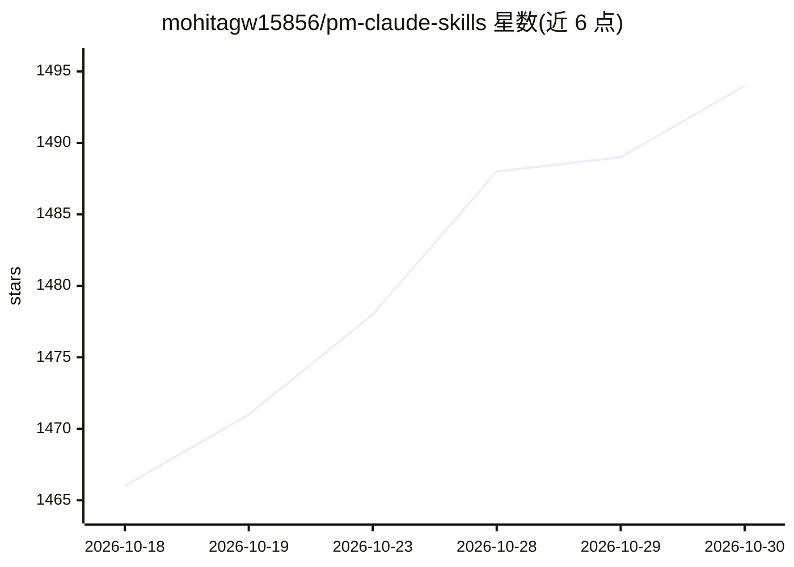

# mohitagw15856/pm-claude-skills

⭐ 1,494 · HTML · MIT · 推送 2026-10-23 · [GitHub](https://github.com/mohitagw15856/pm-claude-skills) · [官网](https://mohitagw15856.github.io/pm-claude-skills/) · 个人维护 · 中文 README

**给普通用户与职场人的 1295 个 AI 助手职业技能库**

开源的 Agent Skills 库：1,295 个纯 markdown 的 SKILL.md 文件，教 AI 助手按资深专业人士标准完成一项任务，如写 PRD、解码租约、无责复盘、裁员补偿估算等，按 152 个技能包组织（含 13 个中文用户技能包）。每个技能包含框架、输出模板、质量检查与反模式。通过 npx 安装器把所选技能复制到工具配置目录，或经 MCP 服务器、REST API 提供；兼容 Claude、ChatGPT、Gemini、Cursor、Codex 等工具，MIT 许可。README 明示高风险技能尚无专业人士审查，且不替代专业意见。

## 筛选速览

| 维度 | 判定 | 备注 |
|---|---|---|
| AI 角色 | `ai-knowledge` | 知识聚合/清单类 |
| 许可风险 | `permissive` | MIT |
| 部署形态 | `library` | 以包/库形式分发 |
| 模型依赖 | locked-api |  |
| 硬件要求 | — | 无带数字的原话,不猜 |
| 安装摩擦 | `low` | 无编译、无系统依赖或容器化 |
| 成熟度 | — | 结构信号不足 |

## 能力要点

- 1,295 个纯 markdown 技能、152 个技能包，覆盖产品经理到求职者多种身份
- 安装即复制文本文件到工具配置目录，卸载即删除，无运行时常驻
- CI 检查结构、安全审计、近重复、翻译一致性与 15 篇对抗性提示注入文档
- 同一 npm 包提供 MCP 服务器与只读 REST API（供 n8n/Make 等自动化使用）

## 适用场景

- 让 AI 助手把访谈笔记直接转成 PRD 与干系人更新
- 解码租约、账单、福利与合同中的关键条款
- 用中文生成周报、述职、复盘等中国职场文档
- 准备面试、模拟公务员面试或写求职跟进信

## 场景标签

`提示工程` · 领域:Agent 开发

## 证据(README 行号)

> L49: PM Skills is an open-source library of 1295 Agent Skills — plain-markdown SKILL.md files that teach an AI assistant
> L69: A skill is one plain-markdown SKILL.md file: a description that tells your assistant when to load it, plus the work
> L110: **用中文提问即可。** 十三个面向中文用户的技能包：周报述职（pm-china-work）、考公考研（pm-china-exams）、劳动合同与补偿（pm-china-life）、外贸、制造业、合规、出海等，73 个技能有简体

## 星数曲线

2026-10-18 1,466 → 2026-10-30 1,494（+28）

---
*卡片 v1 · prompt 1.4 · 生成 2026-10-21 · 置信度 high · 依据 README sha `6fd83cf7f835` · [字段定义](../../DATASET.md)*
