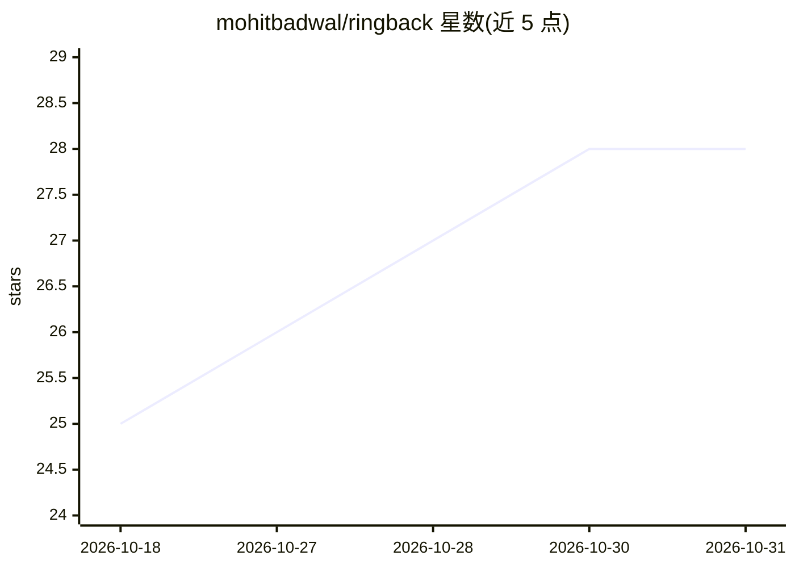

# mohitbadwal/ringback

⭐ 28 · Python · Apache-2.0 · 推送 2026-06-23 · [GitHub](https://github.com/mohitbadwal/ringback) · 个人维护

**让 AI agent 通过 SIP 打电话给用户的 MCP 服务器套件**

ringback 提供两个 MCP 服务器：ringback-voice 让 LLM 通过免费 Linphone SIP 账号拨打用户手机并双向通话（whisper.cpp STT + Piper/say TTS，支持 barge-in 打断），ringback-alert 提供 ntfy/Pushover/SIP 分级通知。全链路自托管、无付费电话服务、无需额外对话 API key，MCP 客户端驱动的模型即语音大脑。支持 macOS/Linux 原生与 Windows（WSL2/Docker）。限制：原生安装需从源码编译 pjsua2（约 20-30 分钟），每轮语音约 1-2 秒延迟，无回声消除，语音功能涉及 GPL 依赖。

## 筛选速览

| 维度 | 判定 | 备注 |
|---|---|---|
| AI 角色 | `ai-ecosystem` | LLM/agent 周边工具 |
| 许可风险 | `permissive` | Apache-2.0 |
| 部署形态 | `self-host` | docker 或自建部署 |
| 模型依赖 | locked-api |  |
| 硬件要求 | — | 无带数字的原话,不猜 |
| 安装摩擦 | `low` | 无编译、无系统依赖或容器化 |
| 成熟度 | — | 结构信号不足 |

## 能力要点

- ringback-voice 提供实时可打断的双向电话会话（call_start/converse/call_end）
- whisper.cpp 语音识别 + Piper/say TTS，含 barge-in 打断机制
- 完全免费自托管：pjsua2 + Linphone SIP，无需 Twilio 或额外 API key
- ringback-alert 支持 ntfy/Pushover/SIP 三通道分级告警

## 适用场景

- 部署失败等紧急事件时让 agent 直接打电话通知我并对话决策
- 离开电脑时通过手机接听 agent 来电处理事务
- 为 MCP 客户端接入分级告警通道替代普通推送

## 场景标签

`语音 Agent` · 领域:对话与助手

## 证据(README 行号)

> L10: **ringback** gives an LLM (Claude, or any MCP client) tools to **reach you on your phone** — from a one-way "fierce
> L18: It ships two MCP servers, `ringback-alert` and `ringback-voice`:

## 星数曲线

2026-10-18 25 → 2026-10-31 28（+3）

---
*卡片 v1 · prompt 1.4 · 生成 2026-10-27 · 置信度 high · 依据 README sha `e7240c91c18d` · [字段定义](../../DATASET.md)*
