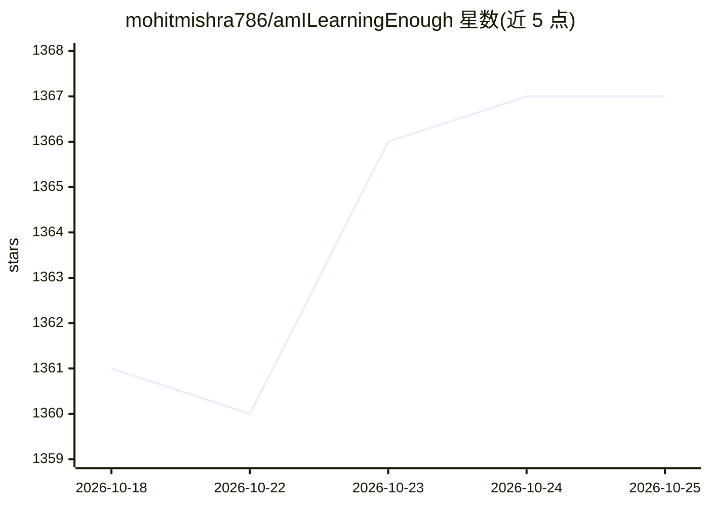

# mohitmishra786/amILearningEnough

⭐ 1,367 · MIT · 推送 2026-03-26 · [GitHub](https://github.com/mohitmishra786/amILearningEnough) · [官网](https://mohitmishra786.github.io/amILearningEnough/) · 个人维护

**低级与系统编程（C/汇编）学习路线图与资源清单**

一个策展型学习资源仓库：提供面向低级编程与系统编程的学习路线图和资料汇编，聚焦 C 语言与汇编（x86），内容涵盖计算机架构理解、系统资源控制、操作系统/驱动/嵌入式开发与调试排错等主题，面向初学者与有经验的开发者。以 Markdown 文档形式发布在 GitHub，配有网站阅读入口，采用 MIT 许可，接受社区贡献。仓库主题标签中包含机器学习/深度学习等词，但 README 正文未展开相关内容。

## 筛选速览

| 维度 | 判定 | 备注 |
|---|---|---|
| AI 角色 | `ai-knowledge` | 知识聚合/清单类 |
| 许可风险 | `permissive` | MIT |
| 部署形态 | `None` |  |
| 模型依赖 | — | README 未给出锁定关系 |
| 硬件要求 | — | 无带数字的原话,不猜 |
| 安装摩擦 | `low` | 无编译、无系统依赖或容器化 |
| 成熟度 | — | 结构信号不足 |

## 能力要点

- 覆盖 C 与 x86 汇编的系统编程学习路线图
- 说明学习动机：计算机架构、高效编码、OS/驱动/嵌入式、调试能力
- 提供网站阅读入口与社区贡献渠道
- MIT 许可

## 适用场景

- 按路线图自学 C 与汇编等低级编程
- 查找系统编程与计算机底层相关的学习资料
- 了解低级编程的适用方向（嵌入式、驱动、操作系统）

## 场景标签

`精选清单` · 领域:学习与行业

## 证据(README 行号)

> L1: # Low-Level Programming And Learning
> L3: This repository provides a comprehensive roadmap and curated resources for learning low-level programming and system

## 星数曲线

2026-10-18 1,361 → 2026-10-25 1,367（+6）

---
*卡片 v1 · prompt 1.4 · 生成 2026-10-21 · 置信度 mid · 依据 README sha `9aaa6f4c194e` · [字段定义](../../DATASET.md)*
