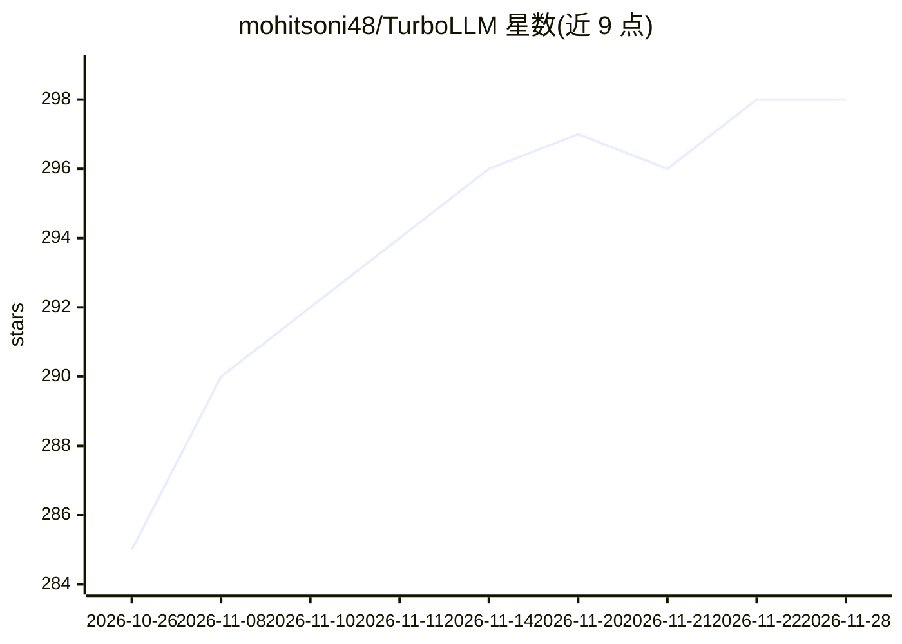

# mohitsoni48/TurboLLM

⭐ 298 · TypeScript · 推送 2026-11-27 · [GitHub](https://github.com/mohitsoni48/TurboLLM) · [官网](https://turbollm.dev) · 个人维护

**本地 LLM 推理管理器：自动适配 GPU 调参并提供兼容 API**

一个 Node 单命令启动的本地 LLM 推理管理器：可指向任意 llama-server 兼容二进制（含社区 fork），按 GPU 自动下载引擎、加载时基准测试并推导启动参数，加载前给出 VRAM 匹配判定；提供 Web 聊天界面与 OpenAI/Anthropic 兼容 API，支持按需加载模型的多模型网关。需 Node ≥22，推理-only（无训练/微调），FSL-1.1 许可，两年后转 Apache-2.0。

## 筛选速览

| 维度 | 判定 | 备注 |
|---|---|---|
| AI 角色 | `ai-ecosystem` | LLM/agent 周边工具 |
| 许可风险 | `none` | — |
| 部署形态 | `self-host` | docker 或自建部署 |
| 模型依赖 | local-ok | 支持本地模型 |
| 硬件要求 | — | 无带数字的原话,不猜 |
| 安装摩擦 | `low` | 无编译、无系统依赖或容器化 |
| 成熟度 | — | 结构信号不足 |

## 能力要点

- 支持任意 llama-server 兼容引擎二进制（含社区 fork），无需自行编译
- 加载时自动基准测试并推导参数，加载前显示 VRAM 匹配判定
- OpenAI 与 Anthropic 兼容 API，网关按请求名按需加载模型
- GGUF 元数据解析、Hugging Face 浏览下载、断点续传与 SHA-256 校验

## 适用场景

- 在本地 GPU 上运行社区 fork 引擎而不手编 flag
- 把 Claude Code 等 agent 指向本地模型
- 复用已有的 LM Studio/Ollama GGUF 模型文件夹
- 同一命令在多模型间切换的本地推理网关

## 场景标签

`推理引擎` `模型网关` · 领域:Agent 开发

## 证据(README 行号)

> L28: API any tool can talk to. TurboLLM is the **performance & bleeding-edge layer for local
> L52: - **🔌 Any engine, including forks.** Point it at any `llama-server`-compatible binary — a
> L63: - **🔀 A gateway that loads models for you.** Name any model in your API request and TurboLLM

## 星数曲线

2026-10-26 285 → 2026-11-28 298（+13）

---
*卡片 v1 · prompt 1.4 · 生成 2026-11-25 · 置信度 mid · 依据 README sha `49a520bd5cea` · [字段定义](../../DATASET.md)*
