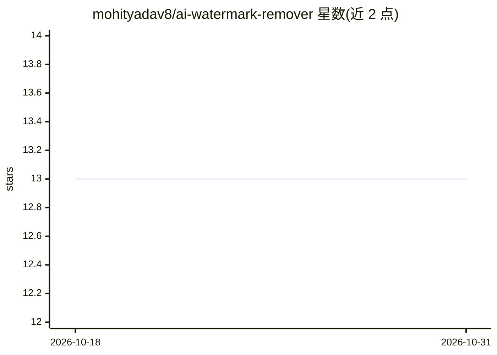

# mohityadav8/ai-watermark-remover

⭐ 13 · Python · NOASSERTION · 推送 2026-10-26 · [GitHub](https://github.com/mohityadav8/ai-watermark-remover) · [官网](https://tools.job-find.xyz) · 个人维护

**检测并剥离文本与文件中 AI 溯源水印的工具（agent 技能+服务）**

由 stdlib Python 清洗引擎、HTTP 服务、浏览器 UI 与 agent 技能四部分组成：Layer A 用确定性脚本清除不可见 Unicode/奇异空格/bidi/标签字符，Layer B 针对统计文本水印（Kirchenbauer green-list、keyed-Gumbel/EXP）走 agent 重写，文件层剥离 C2PA/EXIF/XMP 元数据，覆盖 PNG/PDF/DOCX/MP4 等约 20 种格式。技能本体不含代码，仅通过 HTTP 驱动引擎，可装进 Claude Code、Cowork、Cursor、Grok 等宿主，另有 PostToolUse 钩子做文件级确定性检查/清洗。清洗全本地运行，无需第三方 AI key；README 明确 skills/ 目录在 main 分支缺失导致技能安装流程当前不可用（服务与 Web 应用不受影响）。

## 筛选速览

| 维度 | 判定 | 备注 |
|---|---|---|
| AI 角色 | `ai-ecosystem` | LLM/agent 周边工具 |
| 许可风险 | `permissive` | NOASSERTION |
| 部署形态 | `self-host` | docker 或自建部署 |
| 模型依赖 | locked-api |  |
| 硬件要求 | — | 无带数字的原话,不猜 |
| 安装摩擦 | `low` | 无编译、无系统依赖或容器化 |
| 成熟度 | — | 结构信号不足 |

## 能力要点

- 确定性脚本清除不可见 Unicode/bidi/标签字符
- 剥离 C2PA/EXIF/XMP 元数据，覆盖图像/文档/音视频约 20 种格式
- PostToolUse 钩子对 agent 写入的文件做确定性检查/清洗（check/clean 两模式）
- 清洗全本地，无需第三方 AI key

## 适用场景

- 在发布自己拥有的内容前清除隐藏 AI 溯源标记
- 检查文件是否携带 C2PA/EXIF/XMP 等 AI 元数据（Inspect 模式不改文件）
- 通过钩子自动拦截 agent 写入文件时的水印

## 场景标签

 · 领域:AI 溯源/隐私工具

## 证据(README 行号)

> L9: **Agent skill + stdlib Python service that strips multi-vendor AI provenance marks from text and files** — for priva
> L18: - 🅰️ **Layer A** — invisible Unicode, exotic spaces, bidi, tag chars → deterministic Python scripts
> L22: **Vendors / ecosystems** *(class-level)*: `Claude` · `Gemini / SynthID-Text` · `OpenAI` provenance surfaces · `open

## 星数曲线

2026-10-18 13 → 2026-10-31 13（+0）

---
*卡片 v1 · prompt 1.4 · 生成 2026-10-31 · 置信度 mid · 依据 README sha `0f4aaa94130e` · [字段定义](../../DATASET.md)*
