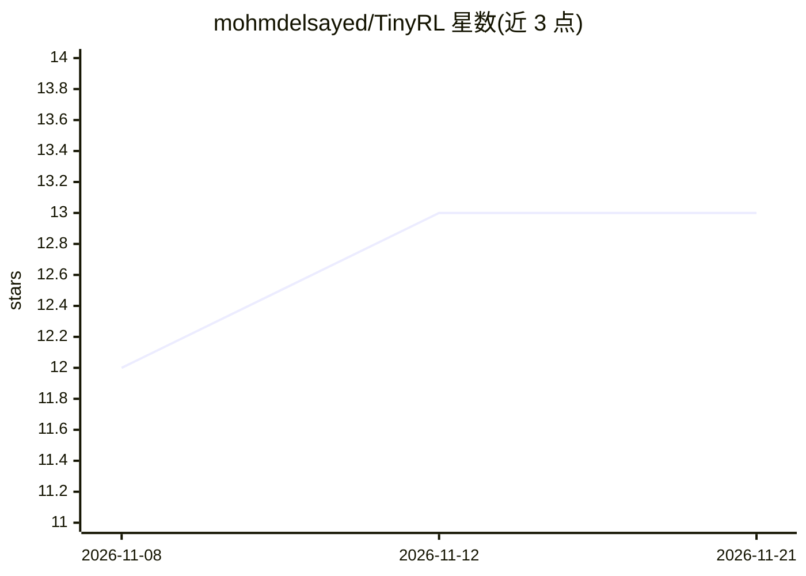

# mohmdelsayed/TinyRL

⭐ 13 · C++ · MIT · 推送 2026-01-24 · [GitHub](https://github.com/mohmdelsayed/TinyRL) · [官网](https://www.tinyrl.ai) · 个人维护

**面向微控制器与嵌入式设备的实时深度强化学习 C++ 框架**

以 header-only C++17 形式发布的轻量深度学习/强化学习框架：包含自动微分核心（反向模式、动态计算图）、神经网络层与 SGD/RMSProp/ObGD 优化器，以及 Stream-X 流式 RL 算法（StreamAC/StreamQ/StreamSARSA）。默认 float32 计算，支持 SSE/NEON SIMD 与嵌入式模式（AG_EMBEDDED），提供 ESP32-S3 的 PlatformIO/Arduino 端上学习示例。可通过 pybind11 绑定在 Python 中使用（源码编译，尚无 PyPI 发布）。构建依赖 C++17 编译器与 CMake 3.14+，Python 绑定另需 pybind11。

## 筛选速览

| 维度 | 判定 | 备注 |
|---|---|---|
| AI 角色 | `ai-native` | 本体是模型或模型工具 |
| 许可风险 | `permissive` | MIT |
| 部署形态 | `library` | 以包/库形式分发 |
| 模型依赖 | — | README 未给出锁定关系 |
| 硬件要求 | — | 无带数字的原话,不猜 |
| 安装摩擦 | `medium` | 含编译或系统依赖之一 |
| 成熟度 | — | 结构信号不足 |

## 能力要点

- Header-only、零依赖，include 即可编译
- Stream-X 流式 RL 算法：StreamAC（连续/离散）、StreamQ、StreamSARSA
- ESP32-S3 端上强化学习示例（PlatformIO/Arduino）
- pybind11 Python 绑定支持 MNIST/CIFAR-10 训练示例

## 适用场景

- 在 ESP32-S3 等微控制器上运行端上强化学习
- 为嵌入式/实时应用构建轻量神经网络
- 在 C++ 项目中使用自动微分训练小型模型
- 实验流式深度 RL 算法

## 场景标签

`强化学习` · 领域:训练与推理

## 证据(README 行号)

> L13: **TinyRL** is a lightweight, header-only C++ deep learning framework designed for real-time reinforcement learning 
> L20: |**Stream-X**|Streaming deep RL algorithms: StreamAC (Actor-Critic), StreamQ (Q-learning with discrete/Atari varian
> L270: An on-device reinforcement learning example is provided in `examples/stream_x_esp32/` using PlatformIO/Arduino.

## 星数曲线

2026-11-08 12 → 2026-11-21 13（+1）

---
*卡片 v1 · prompt 1.4 · 生成 2026-11-18 · 置信度 mid · 依据 README sha `57611b734b6b` · [字段定义](../../DATASET.md)*
