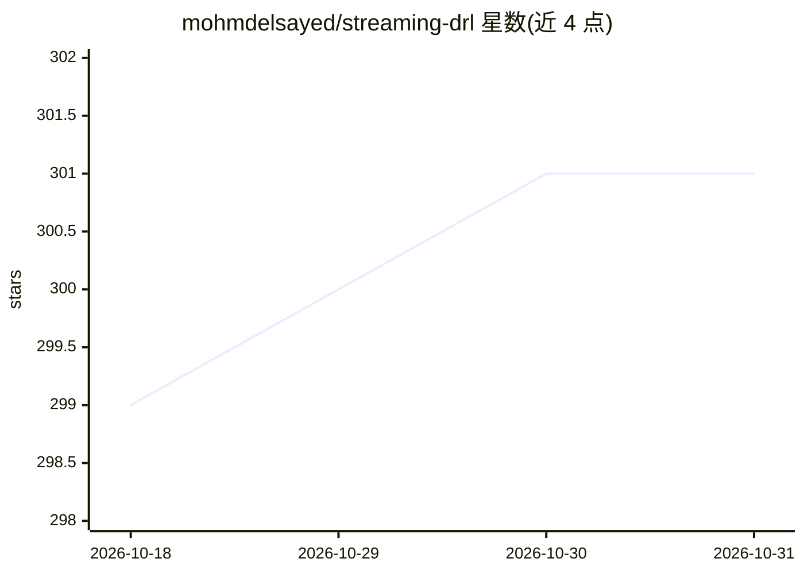

# mohmdelsayed/streaming-drl

⭐ 301 · Python · NOASSERTION · 推送 2026-09-22 · [GitHub](https://github.com/mohmdelsayed/streaming-drl) · 个人维护

**流式深度强化学习算法 Stream-X 的官方论文实现**

论文《Streaming Deep Reinforcement Learning Finally Works》（2026 版）的官方实现，包含 Stream-AC、Stream-RAC、Stream-Q、Stream-SARSA 四种算法。这些算法直接从经验流学习，不使用经验回放缓冲区、目标网络或批量更新，通过信号归一化、表征稳定与受控参数更新的 Stream-X 配方克服所谓 stream barrier。支持经典控制、MuJoCo、Atari、dm_control 环境的命令行运行，附学习曲线绘图脚本，2024 版实现在另一分支保留。许可证为 CC BY-NC 4.0（非商业）。

## 筛选速览

| 维度 | 判定 | 备注 |
|---|---|---|
| AI 角色 | `ai-native` | 本体是模型或模型工具 |
| 许可风险 | `none` | NOASSERTION |
| 部署形态 | `library` | 以包/库形式分发 |
| 模型依赖 | — | README 未给出锁定关系 |
| 硬件要求 | — | 无带数字的原话,不猜 |
| 安装摩擦 | `low` | 无编译、无系统依赖或容器化 |
| 成熟度 | — | 结构信号不足 |

## 能力要点

- 实现 Stream-AC/Stream-RAC/Stream-Q/Stream-SARSA 四种流式深度 RL 算法
- 无需经验回放缓冲区、目标网络或批量更新
- 支持 MuJoCo/Atari/dm_control/经典控制环境，附绘图脚本
- 每算法一种固定超参配置跨任务使用

## 适用场景

- 在连续控制或 Atari 任务上运行流式 RL 算法复现论文结果
- 资源受限或隐私敏感场景下研究无经验缓冲的深度 RL
- 基于 Stream-X 配方开发新的流式 RL 算法

## 场景标签

`强化学习` · 领域:训练与推理

## 证据(README 行号)

> L3: This is the official **2026 implementation** of the Streaming Deep Reinforcement Learning Finally Works paper by Moh
> L5: Stream-X algorithms learn directly from their stream of experience. Here we include implementation of Stream-AC, Str
> L10: Learning from a stream of experience as it arrives, also known as streaming learning, is a core part of natural lea

## 星数曲线

2026-10-18 299 → 2026-10-31 301（+2）

---
*卡片 v1 · prompt 1.4 · 生成 2026-10-21 · 置信度 high · 依据 README sha `488111432a11` · [字段定义](../../DATASET.md)*
