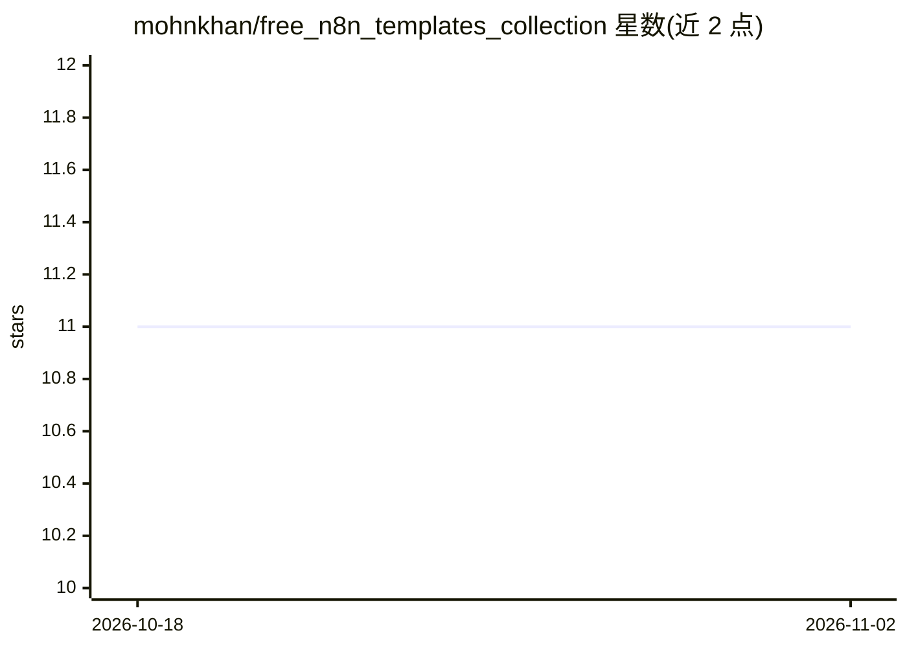

# mohnkhan/free_n8n_templates_collection

⭐ 11 · MIT · 推送 2025-11-06 · [GitHub](https://github.com/mohnkhan/free_n8n_templates_collection) · 个人维护

**互联网来源的 n8n 自动化模板聚合清单，覆盖邮件/Telegram/表格等**

从互联网收集并按 Gmail 邮件、Telegram、Google Drive/Sheets、WordPress、PDF 文档处理等类别组织的 n8n 工作流模板清单，每个条目给出标题、描述、适用部门与模板链接。声明中说明模板均来自网络，作者非创建者且不承担责任，版权归原创建者。条目多为 AI 驱动的自动化场景（OpenAI/DeepSeek/Gemini 等模型节点）。仓库本身不含代码或安装流程，仅作索引与分享用途。

## 筛选速览

| 维度 | 判定 | 备注 |
|---|---|---|
| AI 角色 | `ai-knowledge` | 知识聚合/清单类 |
| 许可风险 | `permissive` | MIT |
| 部署形态 | `self-host` | docker 或自建部署 |
| 模型依赖 | — | README 未给出锁定关系 |
| 硬件要求 | — | 无带数字的原话,不猜 |
| 安装摩擦 | `low` | 无编译、无系统依赖或容器化 |
| 成熟度 | — | 结构信号不足 |

## 能力要点

- 按 Gmail/Telegram/Google Drive/WordPress/PDF 等类别组织的模板索引
- 每条含标题、描述、适用部门与模板链接
- 模板大量使用 OpenAI、Gemini、DeepSeek、LangChain 等 AI 节点
- 声明模板均来自网络、版权归原创建者

## 适用场景

- 查找现成的 n8n 自动化工作流模板
- 了解邮件分类、Telegram 机器人、RAG 问答等场景的 n8n 实现方式
- 按部门（Ops/Support/HR/Security 等）筛选适用的自动化模板

## 场景标签

`工作流自动化` `精选清单` · 领域:效率与自动化

## 证据(README 行号)

> L3: This repository contains a collection of n8n automation templates sourced from the internet. These templates are des
> L12: |Title|Description|Department|Link|

## 星数曲线

2026-10-18 11 → 2026-11-02 11（+0）

---
*卡片 v1 · prompt 1.4 · 生成 2026-11-02 · 置信度 mid · 依据 README sha `589f68e83cd8` · [字段定义](../../DATASET.md)*
