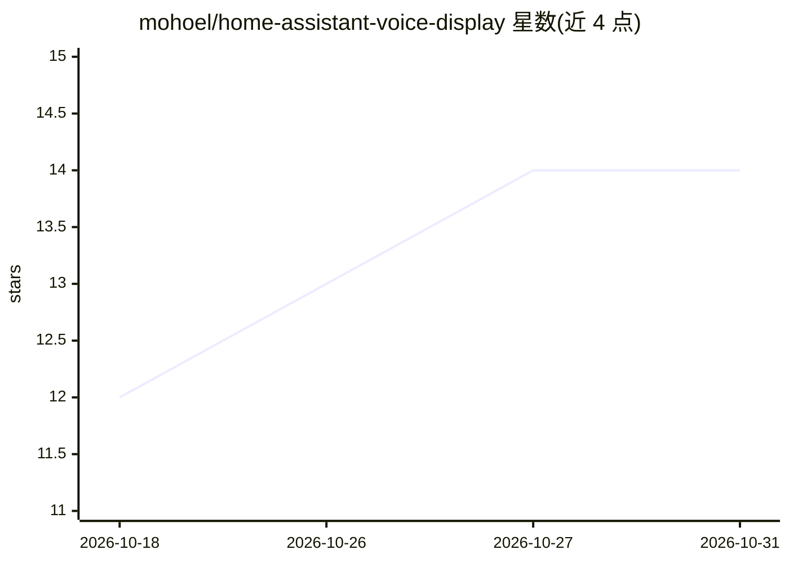

# mohoel/home-assistant-voice-display

⭐ 14 · MIT · 推送 2026-10-23 · [GitHub](https://github.com/mohoel/home-assistant-voice-display) · [官网](https://mohoel.github.io/home-assistant-voice-display/) · 个人维护

**给 Home Assistant 用户的圆形 AMOLED 语音卫星固件**

面向 Waveshare ESP32-S3-Touch-AMOLED-1.75 开发板的 ESPHome 固件，把 Home Assistant Assist 语音助手以带屏设备形式呈现：唤醒词监听（本地 micro_wake_word 或 HA 侧）、状态可视化（麦克风/波点/均衡器/表情脸）、待机时钟与表盘、语音定时器倒计时环、点击事件与提示图标。语音处理管线（Whisper/Piper 或 LLM 对话代理）由 Home Assistant 决定，固件不参与。浏览器刷机、通过 HA 实体与蓝图配置，德语回复的启发式检测仅匹配德语词。

## 筛选速览

| 维度 | 判定 | 备注 |
|---|---|---|
| AI 角色 | `ai-ecosystem` | LLM/agent 周边工具 |
| 许可风险 | `permissive` | MIT |
| 部署形态 | `None` |  |
| 模型依赖 | — | README 未给出锁定关系 |
| 硬件要求 | — | 无带数字的原话,不猜 |
| 安装摩擦 | `low` | 无编译、无系统依赖或容器化 |
| 成熟度 | — | 结构信号不足 |

## 能力要点

- 唤醒/思考/回复各阶段在 466×466 AMOLED 上可视化，可选动画表情脸
- 唤醒词引擎本地（micro_wake_word）或 HA 侧可切换，无需重启
- 语音定时器：屏幕边缘倒计时环，剩余时间暴露为 HA 文本传感器
- 浏览器 ESP Web Tools 一键刷机，后续更新经 HA Updates 完成

## 适用场景

- 为 Home Assistant 添加带屏幕的语音卫星设备
- 用语音控制设备并以屏幕查看状态、测量值与定时器
- 利用蓝图在屏幕/扬声器上推送门铃、漏水等事件提示

## 场景标签

`语音 Agent` · 领域:对话与助手

## 证据(README 行号)

> L43: How a request is processed — fully local (Whisper, Piper) or via a
> L44: language model like Claude as the conversation agent — is decided entirely
> L45: by the Assist pipeline in

## 星数曲线

2026-10-18 12 → 2026-10-31 14（+2）

---
*卡片 v1 · prompt 1.4 · 生成 2026-10-31 · 置信度 high · 依据 README sha `7a93dbb4fb24` · [字段定义](../../DATASET.md)*
