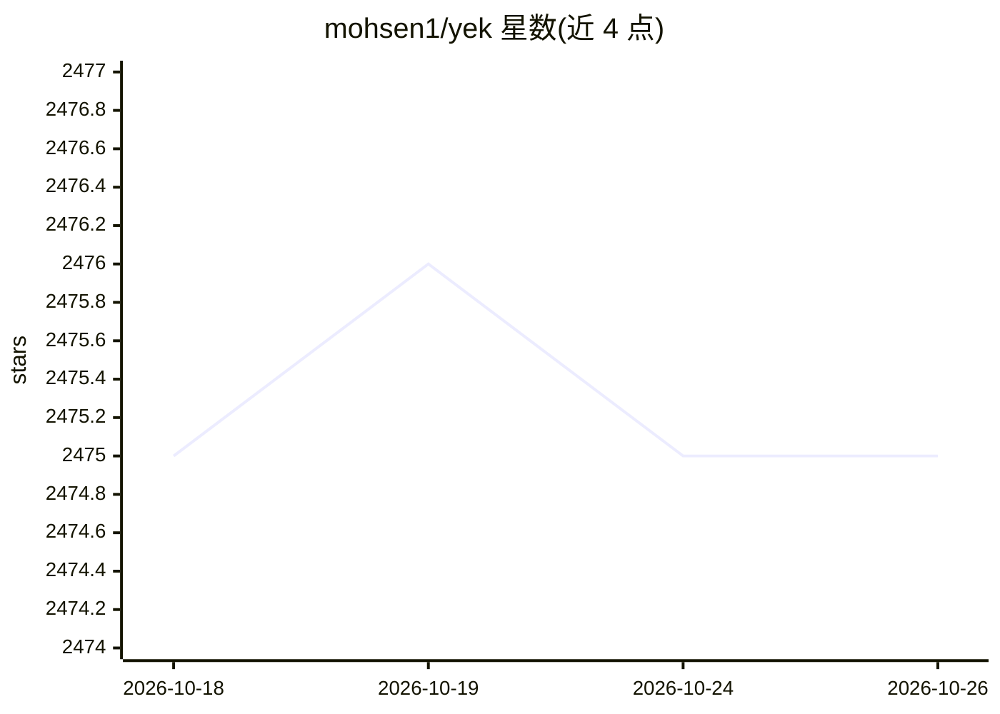

# mohsen1/yek

⭐ 2,475 · Rust · MIT · 推送 2026-06-29 · [GitHub](https://github.com/mohsen1/yek) · 个人维护

**Rust 命令行工具：把仓库文本文件序列化为单文件供 LLM 使用**

yek 是用 Rust 编写的 CLI 工具，将目录或仓库中的文本文件序列化为单个输出文件或管道流，供 LLM 消费。默认遵循 .gitignore 规则、依据 Git 历史推断文件重要性、自动跳过二进制与大文件；重要文件排在输出末尾以适配 LLM 注意力特性。支持按字节或 token 数限制输出、glob 选择、多目录处理、JSON 输出、yek.yaml 配置。提供脚本安装与源码构建两种途径。

## 筛选速览

| 维度 | 判定 | 备注 |
|---|---|---|
| AI 角色 | `ai-ecosystem` | LLM/agent 周边工具 |
| 许可风险 | `permissive` | MIT |
| 部署形态 | `library` | 以包/库形式分发 |
| 模型依赖 | — | README 未给出锁定关系 |
| 硬件要求 | — | 无带数字的原话,不猜 |
| 安装摩擦 | `low` | 无编译、无系统依赖或容器化 |
| 成熟度 | — | 结构信号不足 |

## 能力要点

- 按 Git 历史推断文件重要性，重要文件排在输出末尾
- 支持 token 计数与字节两种输出上限模式，超限文件被移除
- 支持管道流式输出、多目录、glob 与 JSON 输出
- 可通过 yek.yaml/toml/json 配置优先级规则与忽略模式

## 适用场景

- 把整个代码仓库打包成单文件喂给 LLM
- 在 token 预算内挑选最重要的代码文件
- 与 pbcopy 等管道配合快速复制仓库内容

## 场景标签

`文档解析` · 领域:知识与检索

## 证据(README 行号)

> L3: A fast Rust based tool to serialize text-based files in a repository or directory for LLM consumption.[^1]
> L36: > `yek` will prioritize more important files to come last in the output. This is useful for LLM consumption since L

## 星数曲线

2026-10-18 2,475 → 2026-10-26 2,475（+0）

---
*卡片 v1 · prompt 1.4 · 生成 2026-10-21 · 置信度 high · 依据 README sha `b16fcffc6b4a` · [字段定义](../../DATASET.md)*
