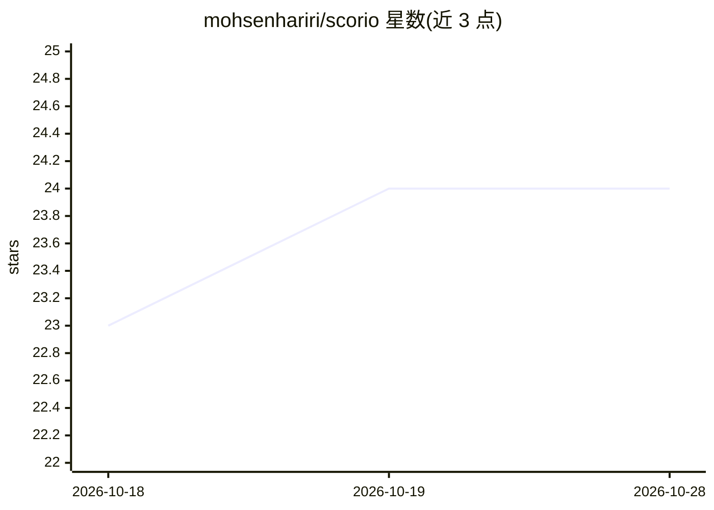

# mohsenhariri/scorio

⭐ 24 · Python · MIT · 推送 2026-10-20 · [GitHub](https://github.com/mohsenhariri/scorio) · [官网](https://mohsenhariri.github.io/scorio/) · 个人维护

**LLM 统计学评测与排名框架：贝叶斯评测、排名与答案聚合**

Bayes@N（ICLR 2026）与 Ranking Reasoning LLMs（ACL 2026）论文的配套实现，提供 Python/Julia/JS-TS 三种语言包。核心函数 bayes(R, w, R0) 以 M×N 试验结果矩阵与评分权重做贝叶斯性能评测并输出后验估计与不确定性；配套 LLM 在 Test-Time Scaling 下的排名方法与答案聚合方法。另在 Hugging Face 发布四个推理数据集（Scorio Trace/Lite/Math/GPQA），并提供评测、排名、聚合教程 notebook。

## 筛选速览

| 维度 | 判定 | 备注 |
|---|---|---|
| AI 角色 | `ai-ecosystem` | LLM/agent 周边工具 |
| 许可风险 | `permissive` | MIT |
| 部署形态 | `library` | 以包/库形式分发 |
| 模型依赖 | — | README 未给出锁定关系 |
| 硬件要求 | — | 无带数字的原话,不猜 |
| 安装摩擦 | `low` | 无编译、无系统依赖或容器化 |
| 成熟度 | — | 结构信号不足 |

## 能力要点

- bayes() 贝叶斯评测函数，输出后验估计 (mu, sigma) 与不确定性量化
- Python/Julia/JavaScript-TypeScript 三语言实现，各自独立包
- 四个 Hugging Face 推理数据集（最多 1,211,520 次尝试）与配套教程 notebook
- 两篇正式接收论文（ICLR 2026 / ACL 2026 Main）支撑方法论

## 适用场景

- 对 LLM 推理输出做带不确定性量化的贝叶斯性能评测
- 在 Test-Time Scaling 场景下对推理 LLM 做统计排名
- 复用发布的推理数据集做评测与聚合实验

## 场景标签

`模型评测` `教程课程` · 领域:评测与运维

## 证据(README 行号)

> L100: #### `bayes(R, w, R0=None)`
> L101: Bayesian performance evaluation with uncertainty quantification using the Bayes@N framework.

## 星数曲线

2026-10-18 23 → 2026-10-28 24（+1）

---
*卡片 v1 · prompt 1.4 · 生成 2026-10-27 · 置信度 high · 依据 README sha `4ed67e98a469` · [字段定义](../../DATASET.md)*
