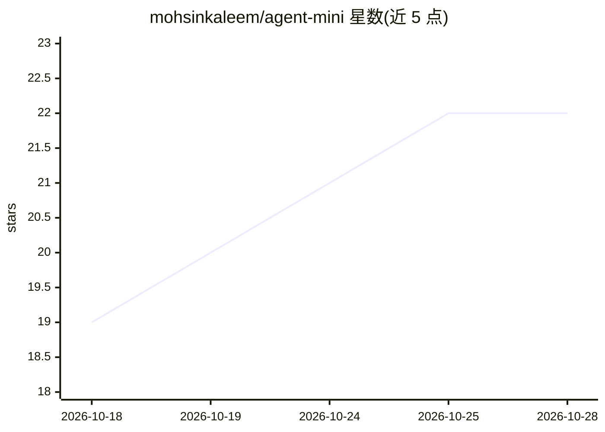

# mohsinkaleem/agent-mini

⭐ 22 · Python · MIT · 推送 2026-10-14 · [GitHub](https://github.com/mohsinkaleem/agent-mini) · 个人维护

**本地优先的轻量 CLI AI agent：shell/文件/网络/记忆工具**

约 3,000 行 Python、无框架的命令行 AI agent，面向在小模型上跑 agent 的开发者。提供 shell、文件读写编辑、列表搜索、DuckDuckGo 网络搜索与抓取、持久记忆等工具，并支持插件扩展。默认接 Ollama，也可用 OpenAI 或任意 OpenAI 兼容服务（LM Studio、vLLM、llama.cpp）。含工作区沙箱、命令审批、/undo、危险命令拦截与 Telegram 网关。附 36 任务评测套件。

## 筛选速览

| 维度 | 判定 | 备注 |
|---|---|---|
| AI 角色 | `ai-native` | 本体是模型或模型工具 |
| 许可风险 | `permissive` | MIT |
| 部署形态 | `library` | 以包/库形式分发 |
| 模型依赖 | local-ok | 支持本地模型 |
| 硬件要求 | — | 无带数字的原话,不猜 |
| 安装摩擦 | `low` | 无编译、无系统依赖或容器化 |
| 成熟度 | — | 结构信号不足 |

## 能力要点

- 约 3,000 行 Python，仅依赖 httpx/click/rich
- 针对 4B/9B 小模型调优，qwen3.5:4b 评测通过率 88%→97%
- 工具集：shell、文件读写编辑、搜索、网络搜索抓取、持久记忆、自定义插件
- 工作区沙箱与审批机制、危险命令拦截、Telegram 网关

## 适用场景

- 在本机小模型上跑一个能操作 shell 和文件的 agent
- 通过 Telegram 从手机使用同一 agent
- 用脚本一条消息调用（one-shot）完成文件统计类任务

## 场景标签

`Agent 框架` · 领域:Agent 开发

## 证据(README 行号)

> L8: A small, local-first AI agent you can read in an afternoon: shell, files, web and memory, driven by a small model on
> L11: - **Built for small models**: tuned and measured on 4B and 9B models with a task-eval harness: on the release candi
> L13: - **Tools**: shell, read/write/edit files, list and search, web search and fetch, persistent memory, plus your own 

## 星数曲线

2026-10-18 19 → 2026-10-28 22（+3）

---
*卡片 v1 · prompt 1.4 · 生成 2026-10-28 · 置信度 high · 依据 README sha `09d2287662db` · [字段定义](../../DATASET.md)*
