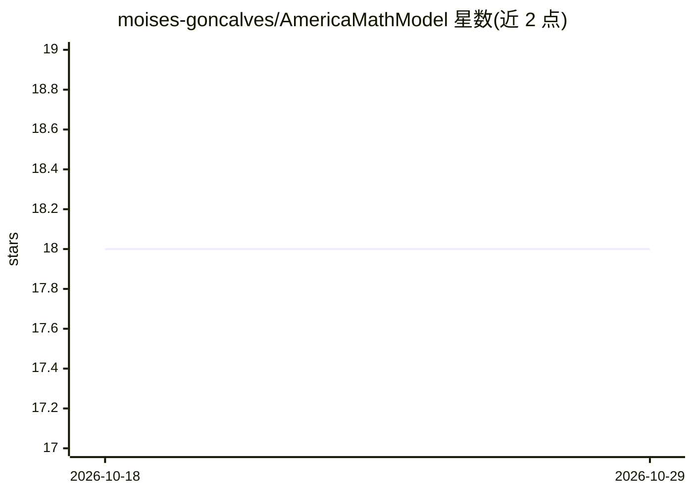

# moises-goncalves/AmericaMathModel

⭐ 18 · Jupyter Notebook · 推送 2026-01-30 · [GitHub](https://github.com/moises-goncalves/AmericaMathModel) · 个人维护 · 中文 README

**面向 MCM/ICM 数学建模竞赛的 Python 工具箱与 Prompt 模板库**

为美国大学生数学建模竞赛提供一站式工具集：包含 8 大类建模场景的 AI Prompt 模板（覆盖数据处理到论文写作全流程）、Nature/IEEE/NeurIPS 风格的图表样式模板、假设检验/回归/时间序列/生存分析等统计分析工具，以及 LightGBM/XGBoost/CatBoost 等机器学习算法封装和 30+ 维度自动化特征工程。以 Python 库与 Markdown 模板形式提供，通过 git clone 源码安装，附 MCM/ICM 各题型适用说明。

## 筛选速览

| 维度 | 判定 | 备注 |
|---|---|---|
| AI 角色 | `ai-ecosystem` | LLM/agent 周边工具 |
| 许可风险 | `none` | — |
| 部署形态 | `None` |  |
| 模型依赖 | — | README 未给出锁定关系 |
| 硬件要求 | — | 无带数字的原话,不猜 |
| 安装摩擦 | `low` | 无编译、无系统依赖或容器化 |
| 成熟度 | — | 结构信号不足 |

## 能力要点

- 8 大类建模场景 AI Prompt 模板（数据处理到论文写作）
- Nature / IEEE / NeurIPS 期刊风格可视化模板一键应用
- 假设检验/回归/时间序列/生存分析等统计分析工具
- 30+ 维度自动化特征工程与机器学习算法封装

## 适用场景

- 参加 MCM/ICM 竞赛时快速搭建建模与可视化流程
- 按建模环节选用对应 Prompt 模板辅助论文写作
- 比赛论文中生成期刊风格的出版级图表

## 场景标签

 · 领域:数学建模/数据科学工具

## 证据(README 行号)

> L39: ### 1. Prompt 模板库
> L41: 针对数学建模全流程的 8 大 Prompt 模板：

## 星数曲线

2026-10-18 18 → 2026-10-29 18（+0）

---
*卡片 v1 · prompt 1.4 · 生成 2026-10-29 · 置信度 mid · 依据 README sha `5b223d34390a` · [字段定义](../../DATASET.md)*
