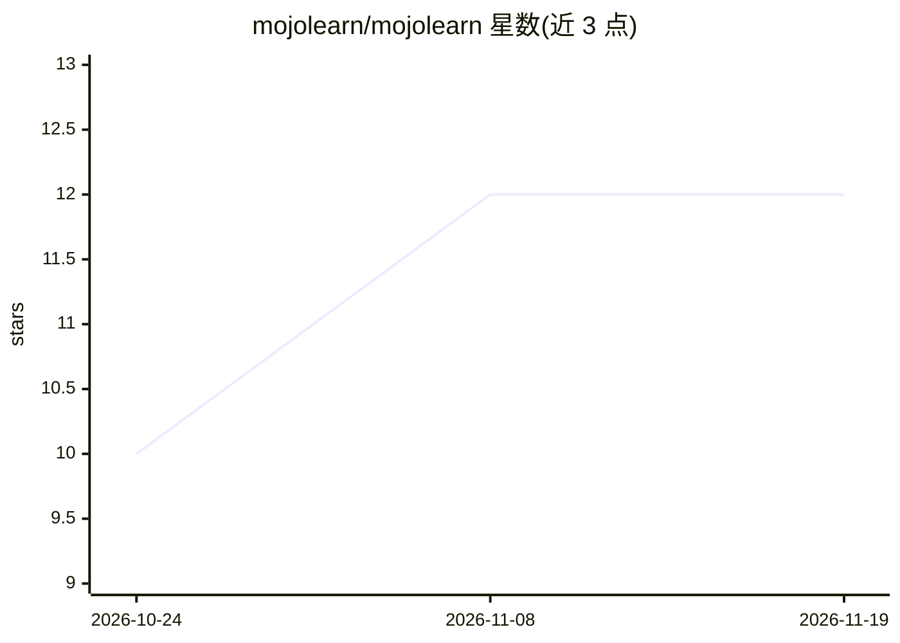

# mojolearn/mojolearn

⭐ 12 · Mojo · Apache-2.0 · 推送 2026-11-18 · [GitHub](https://github.com/mojolearn/mojolearn) · [官网](https://mojolearn.org) · 个人维护

**跨 Apple/NVIDIA/AMD GPU 逐位一致推理与训练的 ML 库**

用 Mojo 实现的 GPU 机器学习库，核心机制是数值契约：固定归约顺序、舍入与初等函数，使同一模型与输入在 Apple Metal、NVIDIA CUDA、AMD HIP GPU 及 x86-64 Linux/Apple silicon CPU 上返回相同比特。提供 100+ 算法、12 个算法族，覆盖 transformers、Mamba-1/2/3、树模型、聚类、时序等，并支持加载他框架训练的神经网络权重、训练中途跨厂商交接、Hugging Face checkpoint 加载与内置验证器。默认 `identical` 模式为全 FP32；`fast` 模式仅限 Apple GPU。README 自述项目处于 alpha 阶段，跨版本不保证比特不变。

## 筛选速览

| 维度 | 判定 | 备注 |
|---|---|---|
| AI 角色 | `ai-native` | 本体是模型或模型工具 |
| 许可风险 | `permissive` | Apache-2.0 |
| 部署形态 | `library` | 以包/库形式分发 |
| 模型依赖 | — | README 未给出锁定关系 |
| 硬件要求 | — | 无带数字的原话,不猜 |
| 安装摩擦 | `medium` | 含编译或系统依赖之一 |
| 成熟度 | `idea` | |

## 能力要点

- 默认 identical 模式在 Metal/CUDA/HIP 及 CPU 上逐位一致
- 100+ 算法与组件，含 Mamba-1/2/3、Samba 与 boosting/聚类/时序等 12 族
- 训练可跨 GPU 厂商中途交接，多厂商 GPU 可共同训练一个模型
- 内置验证器与参考哈希，可核验本机与已记录结果一致

## 适用场景

- 部署模型在不同厂商 GPU 间迁移时不产生数值差异
- 审计场景中回放已记录的决策并复现结果
- 在 Mac 自带 GPU 上运行树模型与神经网络的训练推理
- 多厂商 GPU 协同参与同一训练任务

## 场景标签

`推理引擎` `模型训练` · 领域:训练与推理

## 证据(README 行号)

> L10: mojolearn is a GPU machine-learning library whose default mode is **identical**.
> L37: One Mojo codebase implements these algorithms across Metal, CUDA and HIP

## 星数曲线

2026-10-24 10 → 2026-11-19 12（+2）

---
*卡片 v1 · prompt 1.4 · 生成 2026-11-18 · 置信度 high · 依据 README sha `5435d5a818fe` · [字段定义](../../DATASET.md)*
