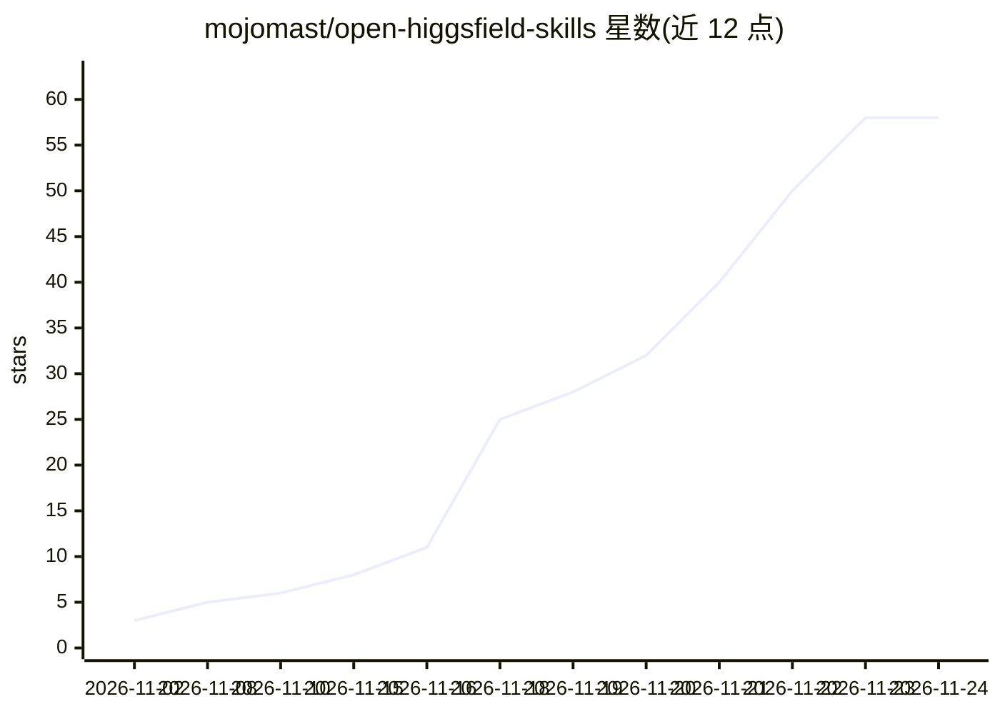

# mojomast/open-higgsfield-skills

⭐ 63 · Python · NOASSERTION · 推送 2026-10-30 · [GitHub](https://github.com/mojomast/open-higgsfield-skills) · 组织维护

**让任意编码代理用开源权重从一句提示生成短片的 37 个技能包**

由 #OpenSourceHiggsfield 黑客松项目构成的 agent 技能包，包含 37 个 Agent Skills（SKILL.md + 纯标准库 Python 脚本 + ComfyUI API 工作流）。核心 video-director 技能把一句话创意分解为故事设定、镜头列表、关键帧、视频镜头、配音、音乐、字幕与成片，全部经用户自备的 ComfyUI 服务器以开源权重模型（FLUX Klein、LTX-2、Qwen-Image-Edit、Wan、Chatterbox、Whisper 等）完成，不含任何模型权重文件。工作流多数仅做静态检查、未在 GPU 上端到端运行，自述处于早期阶段。提供 Google Colab 运行器技能与 70 条数据驱动路由。

## 筛选速览

| 维度 | 判定 | 备注 |
|---|---|---|
| AI 角色 | `ai-native` | 本体是模型或模型工具 |
| 许可风险 | `none` | NOASSERTION |
| 部署形态 | `None` |  |
| 模型依赖 | — | README 未给出锁定关系 |
| 硬件要求 | — | 无带数字的原话,不猜 |
| 安装摩擦 | `medium` | 含编译或系统依赖之一 |
| 成熟度 | `idea` | |

## 能力要点

- video-director 编排：提示→故事设定→镜头→关键帧→视频→配音→成片，全程记录到可恢复的 JSON manifest
- 37 个技能、70 条路由，覆盖图生视频、口型同步、背景抠除、镜头控制、LoRA 训练等
- 仅用开源权重，不含闭管生成 API，仓库不打包模型权重
- comfyui-preflight 预检节点与权重文件；Google Colab 运行器支持 GPU 分档（draft 16GB / standard 24GB / max 40GB）

## 适用场景

- 让 Claude Code、Codex、Cursor 等编码代理担任视频制作团队，从一句话产出短片
- 在自己的 ComfyUI 服务器或 Google Colab 上用开源权重跑完整视频生产流水线
- 按需求（如对白镜头、去物体）查询路由表选用对应技能与工作流

## 场景标签

`视频生成` `图像生成` · 领域:内容生成

## 证据(README 行号)

> L7: **One prompt in, a finished short video out, using only open-weights models on your own ComfyUI.**
> L9: `open-higgsfield-skills` is an agent-agnostic pack of **37 Agent Skills** that teaches any coding agent (Claude Code
> L36: - **Open weights only.** No skill calls a closed or hosted generation API. You bring a ComfyUI server (local GPU, G

## 星数曲线

2026-11-02 3 → 2026-11-24 58（+55）

---
*卡片 v1 · prompt 1.4 · 生成 2026-11-18 · 置信度 high · 依据 README sha `df4800d3aadc` · [字段定义](../../DATASET.md)*
