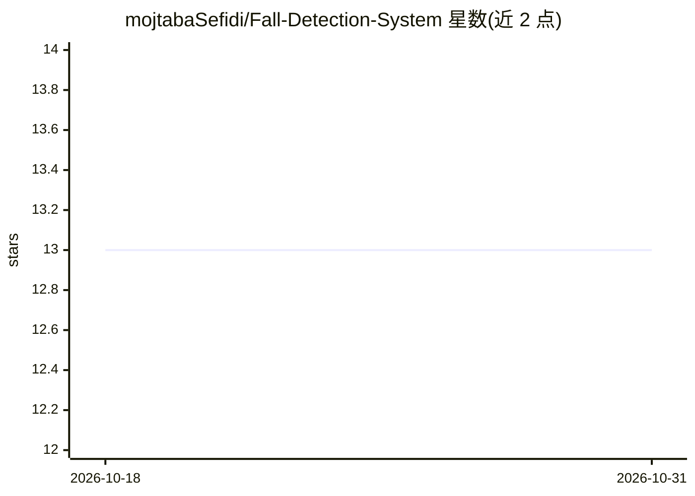

# mojtabaSefidi/Fall-Detection-System

⭐ 13 · Jupyter Notebook · GPL-3.0 · 推送 2026-08-20 · [GitHub](https://github.com/mojtabaSefidi/Fall-Detection-System) · [官网](https://www.primeopenaccess.com/scholarly-articles/comparative-study-on-performance-of-ml-models-for-fall-detection-in-older-people.pdf) · 个人维护

**论文官方代码：SisFall 数据集上的跌倒检测 ML 基线对比**

论文《Comparative Study on Performance of ML Models for Fall Detection in Older People》的官方实现，在 SisFall 数据集（双加速度计+单陀螺仪，200Hz，九通道）上构建可复现的二分类跌倒检测基线：按时间顺序划分试验（R01–R04 开发、R05 测试），一秒窗口二分类标签，对比固定传统基线（多数类、SGD 逻辑回归、随机森林）与一个紧凑 1D CNN，报告准确率、F1、ROC-AUC、PR-AUC 等标准指标。以 Jupyter notebook 运行，默认不写盘，需自行放置数据集。

## 筛选速览

| 维度 | 判定 | 备注 |
|---|---|---|
| AI 角色 | `ai-native` | 本体是模型或模型工具 |
| 许可风险 | `viral` | GPL-3.0 |
| 部署形态 | `library` | 以包/库形式分发 |
| 模型依赖 | — | README 未给出锁定关系 |
| 硬件要求 | — | 无带数字的原话,不猜 |
| 安装摩擦 | `low` | 无编译、无系统依赖或容器化 |
| 成熟度 | — | 结构信号不足 |

## 能力要点

- SisFall 九通道传感器数据的二分类跌倒检测基线
- 时间顺序试验划分，窗口不跨划分边界，报告各划分覆盖
- 传统基线（dummy/SGD/随机森林）与紧凑 1D CNN 对比
- 支持版本化预处理缓存、产物与模型持久化（默认关闭）

## 适用场景

- 复现论文中的跌倒检测模型对比实验
- 在 SisFall 数据上扩展自定义跌倒检测模型
- 学习传感器时间序列的划分、标准化与不平衡处理流程

## 场景标签

`模型评测` · 领域:评测与运维

## 证据(README 行号)

> L3: Official implementation of [Comparative Study on Performance of ML Models for
> L8: This repository provides a reproducible binary baseline for the SisFall dataset.
> L10: sample is label `1`. The experiment compares fixed traditional baselines with one

## 星数曲线

2026-10-18 13 → 2026-10-31 13（+0）

---
*卡片 v1 · prompt 1.4 · 生成 2026-10-31 · 置信度 high · 依据 README sha `d6e8b1829684` · [字段定义](../../DATASET.md)*
