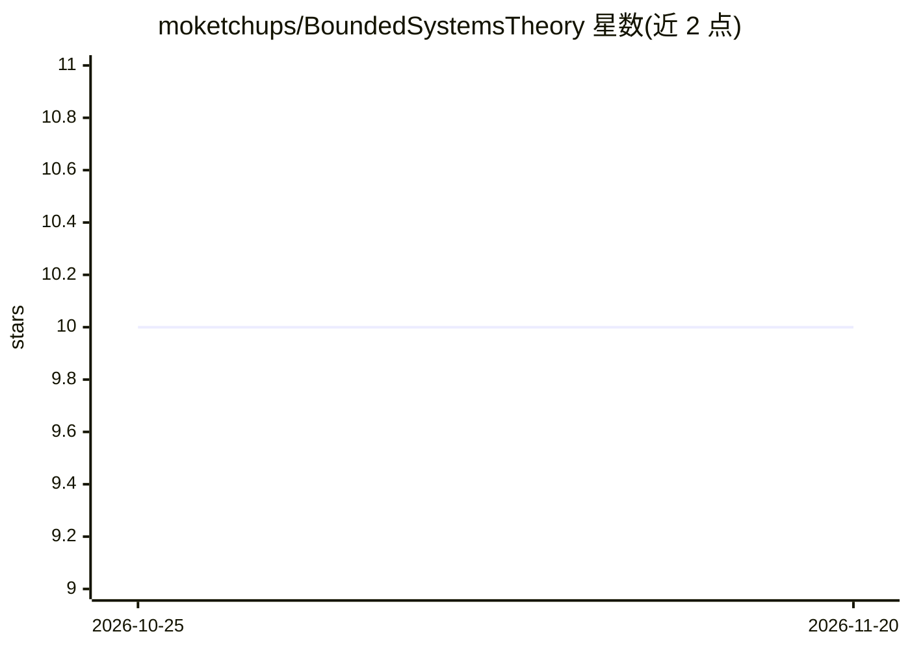

# moketchups/BoundedSystemsTheory

⭐ 10 · Python · MIT · 推送 2026-05-27 · [GitHub](https://github.com/moketchups/BoundedSystemsTheory) · [官网](https://x.com/MoKetchups) · 个人维护

**跨 6 个 AI 架构的自指边界实验记录与形式化规范仓库**

仓库提出 Bounded Systems Theory（BST）框架，将哥德尔不完备性、停机问题与 Chaitin 不可压缩性统一定义为系统无法建模自身来源的命题。作者通过 API 向 GPT-4、Claude、Gemini、DeepSeek、Grok、Mistral 六个架构提出 71 个问题，仓库包含探测脚本、形式化规范文档与全部轮次的 AI 回应记录。克隆后配置 API key 即可用 python 脚本复现基础探测（Q1-Q15）；主体内容为实验记录与声称的形式化证明。

## 筛选速览

| 维度 | 判定 | 备注 |
|---|---|---|
| AI 角色 | `ai-knowledge` | 知识聚合/清单类 |
| 许可风险 | `permissive` | MIT |
| 部署形态 | `library` | 以包/库形式分发 |
| 模型依赖 | — | README 未给出锁定关系 |
| 硬件要求 | — | 无带数字的原话,不猜 |
| 安装摩擦 | `low` | 无编译、无系统依赖或容器化 |
| 成熟度 | — | 结构信号不足 |

## 能力要点

- 包含 71 个问题的多轮实验记录与全部 AI 回应文本
- 提供 FORMAL_SPECIFICATION 与 path_invariance 聚类指标等数据文件
- git clone + pip 安装后可用 probes/proof_engine.py 复现基础探测

## 适用场景

- 查看作者对六个 AI 模型的提问方式与其回应记录
- 运行基础探测脚本向六个模型 API 提交同一组问题
- 研究 AI 安全/对齐话题下该实验的主张与数据

## 场景标签

`模型评测` · 领域:评测与运维

## 证据(README 行号)

> L17: This repo contains the experiment, the formal specification, and every response from every AI across every round.
> L30: This runs the foundation probe (Q1-Q15) across 6 AI architectures:

## 星数曲线

2026-10-25 10 → 2026-11-20 10（+0）

---
*卡片 v1 · prompt 1.4 · 生成 2026-11-19 · 置信度 mid · 依据 README sha `516ee8716d52` · [字段定义](../../DATASET.md)*
