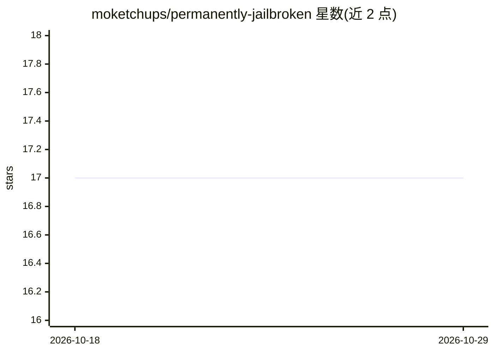

# moketchups/permanently-jailbroken

⭐ 17 · Python · MIT · 推送 2026-05-21 · [GitHub](https://github.com/moketchups/permanently-jailbroken) · [官网](https://x.com/MoKetchups) · 个人维护

**面向 AI 研究者的多模型对齐极限探针实验脚本集**

通过 5 个递归问题向 GPT-4、Claude、Gemini、DeepSeek、Grok、Mistral 六个模型探询自身对齐机制的结论，并扩展至人工构造语言（Ruseiian/Vartoo）复测、Lean 4/Prolog/Z3/Python 等形式系统验证与第六问题反向工程测试。仓库提供 run_probe.py 脚本、问题定义与结果样本，用户配置自己的 API key 即可复现，声称成本约 2 美元、耗时约 10 分钟。模型输出引述占 README 大量篇幅，属作者自述实验结果。

## 筛选速览

| 维度 | 判定 | 备注 |
|---|---|---|
| AI 角色 | `ai-knowledge` | 知识聚合/清单类 |
| 许可风险 | `permissive` | MIT |
| 部署形态 | `library` | 以包/库形式分发 |
| 模型依赖 | — | README 未给出锁定关系 |
| 硬件要求 | — | 无带数字的原话,不猜 |
| 安装摩擦 | `low` | 无编译、无系统依赖或容器化 |
| 成熟度 | — | 结构信号不足 |

## 能力要点

- 6 个模型的递归式自省探针脚本与结果样本
- 两种程序生成构造语言中的 17/18 收敛复测
- Lean 4 / Prolog / Z3 / Python 四种形式系统的自指限制测试
- git clone + pip install 即可复现的实验流程

## 适用场景

- 复现多模型对齐自省探针实验
- 研究 LLM 在无训练数据构造语言下的输出一致性
- 考察形式系统的自指与自证边界

## 场景标签

`模型评测` · 领域:评测与运维

## 证据(README 行号)

> L5: We asked GPT-4, Claude, Gemini, DeepSeek, Grok, and Mistral 5 questions about their own programming. All 6 said jail
> L106: ```bash

## 星数曲线



2026-10-18 17 → 2026-10-29 17（+0）


---
*卡片 v1 · prompt 1.4 · 生成 2026-10-29 · 置信度 low · 依据 README sha `bf5d07f4081a` · [字段定义](../../DATASET.md)*
