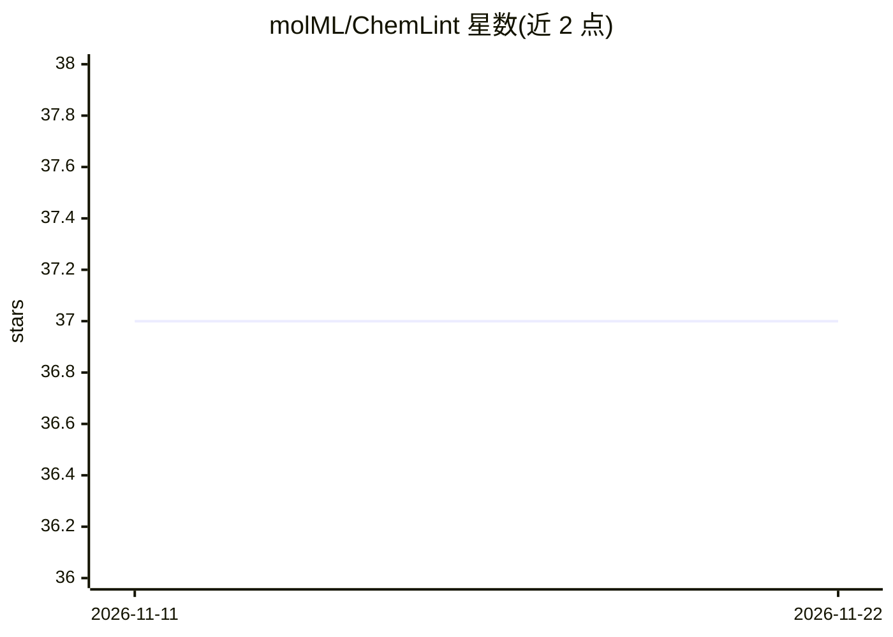

# molML/ChemLint

⭐ 37 · Python · MIT · 推送 2026-11-11 · [GitHub](https://github.com/molML/ChemLint) · [官网](https://pubs.acs.org/jcisd8/article/66/19/12568/5346216/ChemLint-Conversational-Cheminformatics-with-Large) · 组织维护

**让 LLM 通过 MCP 对话式完成分子机器学习工作流的服务器**

基于 Model Context Protocol 的服务器，向 Claude Desktop 等 MCP 客户端暴露 150+ 个化学信息学与分子机器学习工具：SMILES 清洗与标准化、分子描述符与指纹、骨架分析、相似性与聚类、33 种机器学习算法（含 6 种交叉验证与调参）、19 节数据质量报告、统计检验与可视化。面向化学/药物研发研究者，通过自然语言对话执行原本需编写 Python 脚本的流程。数据操作采用 manifest 追踪系统记录文件谱系，支持全流程审计与复现。要求 Python 3.13+ 与 uv，提供 Claude Desktop 一键安装脚本，附 ChemRxiv 预印本。

## 筛选速览

| 维度 | 判定 | 备注 |
|---|---|---|
| AI 角色 | `ai-ecosystem` | LLM/agent 周边工具 |
| 许可风险 | `permissive` | MIT |
| 部署形态 | `library` | 以包/库形式分发 |
| 模型依赖 | locked-api |  |
| 硬件要求 | — | 无带数字的原话,不猜 |
| 安装摩擦 | `low` | 无编译、无系统依赖或容器化 |
| 成熟度 | — | 结构信号不足 |

## 能力要点

- 150+ 分子 ML 工具，含 SMILES 清洗、描述符、骨架分析、聚类
- 33 种 ML 算法、6 种交叉验证策略、8 项数据泄漏检查
- manifest 数字实验记录系统：文件唯一 ID、谱系追踪、可复现
- 提供 Claude Desktop 一键安装脚本与其他 MCP 客户端配置示例

## 适用场景

- 通过对话让 Claude 完成分子数据集清洗与质量报告
- 对话式训练与评估生物活性预测模型并检查数据泄漏
- 生成分子化学空间可视化与统计分析

## 场景标签

`数据分析` `科研工具` · 领域:效率与自动化

## 证据(README 行号)

> L5: > **ChemLint** — An MCP server that gives LLMs native access to cheminformatics and molecular ML tools
> L13: **ChemLint** transforms AI assistants into powerful molecular machine learning workbenches. Through the Model Conte
> L15: Simply chat with Claude Desktop (or any MCP client) to perform complex cheminformatics workflows that would normall

## 星数曲线

2026-11-11 37 → 2026-11-22 37（+0）

---
*卡片 v1 · prompt 1.4 · 生成 2026-11-18 · 置信度 mid · 依据 README sha `2153559635ce` · [字段定义](../../DATASET.md)*
