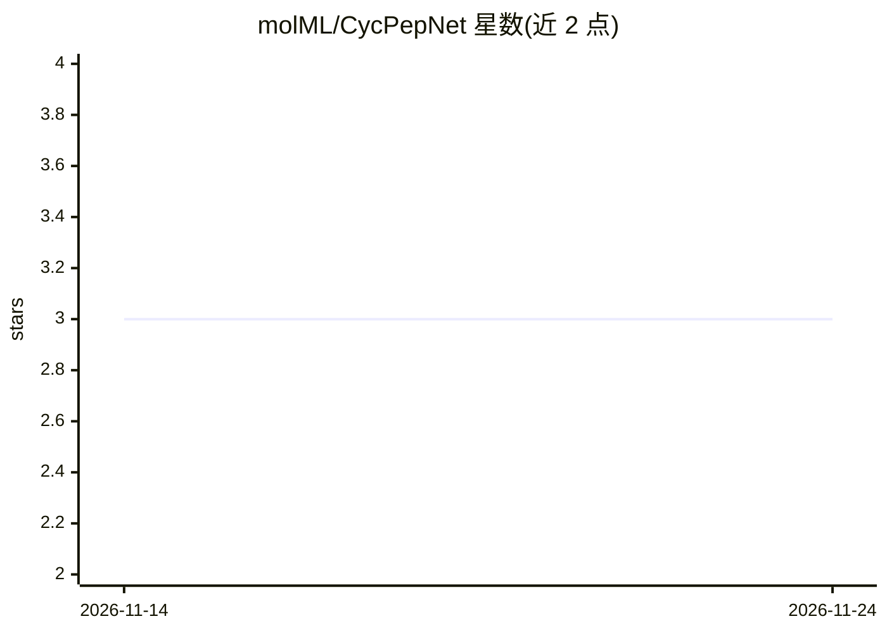

# molML/CycPepNet

⭐ 3 · Python · MIT · 推送 2026-11-12 · [GitHub](https://github.com/molML/CycPepNet) · [官网](https://chemrxiv.org/doi/full/10.26434/chemrxiv.15011871/v1) · 组织维护

**面向科研人员的环肽性质预测基准框架，比较分子表征与ML模型**

随论文《Assessing the predictive limits of machine learning on cyclic peptides》发布的开源基准框架：覆盖 20 个回归/分类任务、45 个模型配置、两种数据划分与五个随机种子，比较指纹、序列模型、图神经网络与预训练化学语言模型对环肽结合亲和力、膜渗透性与半衰期的预测。保存的运行记录使所有分析与图表可在不重训模型的情况下复现；自带 verify/reproduce 流程校验数据哈希与输出一致性。安装走 Pixi（锁 Linux/Apple Silicon/CUDA 12.8）或 Conda，Windows 未覆盖需用 WSL。

## 筛选速览

| 维度 | 判定 | 备注 |
|---|---|---|
| AI 角色 | `ai-native` | 本体是模型或模型工具 |
| 许可风险 | `permissive` | MIT |
| 部署形态 | `desktop` | 安装包/桌面程序 |
| 模型依赖 | — | README 未给出锁定关系 |
| 硬件要求 | — | 无带数字的原话,不猜 |
| 安装摩擦 | `medium` | 含编译或系统依赖之一 |
| 成熟度 | — | 结构信号不足 |

## 能力要点

- 20 个任务 × 45 个模型配置 × 2 种划分 × 5 种子的完整基准矩阵
- 保存的 9,000 条运行记录支持无重训练复现，verify 命令哈希校验 40 个数据划分
- 支持训练自带模型、评测用户自建模型或重建数据集三条路径
- 预训练 GNN 与化学语言模型（ChemBERTa2、peptide CLM）纳入比较

## 适用场景

- 复现论文中环肽 ML 基准的结果与图表
- 在新任务上训练自带的 RF/XGBoost/LSTM/GCN 等模型
- 用框架统一的划分与指标评测自己提出的分子表征或模型
- 按哈希校验从外部获取的环肽数据集快照

## 场景标签

`模型评测` `科研工具` · 领域:评测与运维

## 证据(README 行号)

> L7: CycPepNet is an open framework that compares molecular representations and machine-learning models for cyclic-peptid
> L9: The framework covers 20 regression/classification tasks, 45 model configurations, two split methods and five trainin

## 星数曲线

2026-11-14 3 → 2026-11-24 3（+0）

---
*卡片 v1 · prompt 1.4 · 生成 2026-11-21 · 置信度 high · 依据 README sha `e72d1029973f` · [字段定义](../../DATASET.md)*
