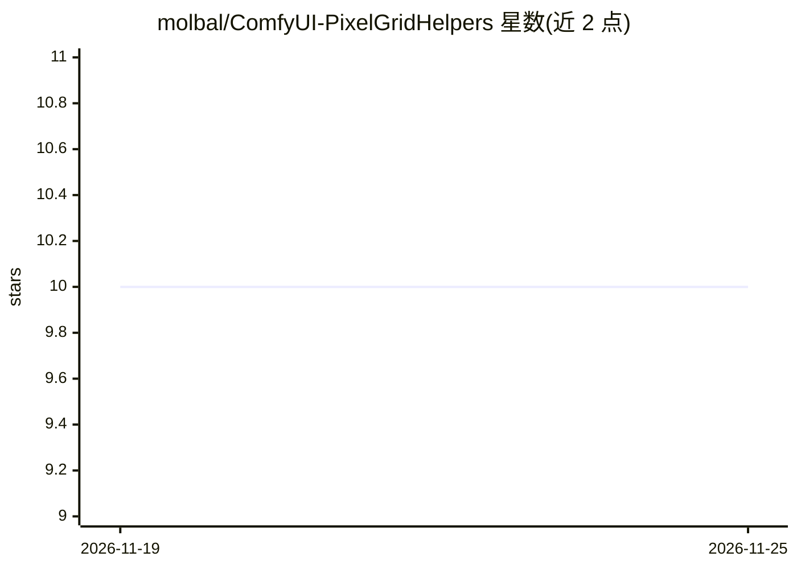

# molbal/ComfyUI-PixelGridHelpers

⭐ 10 · Python · 推送 2026-10-05 · [GitHub](https://github.com/molbal/ComfyUI-PixelGridHelpers) · [官网](https://registry.comfy.org/publishers/molbal/nodes/comfyui-pixelgrid-helpers) · 个人维护

**ComfyUI 像素画生成与处理的自定义节点套件**

为 ComfyUI 提供的一组自定义节点，面向像素化图像的生成后处理：色彩量化、调色板提取与应用、相似色合并、放大像素画的网格对齐修复（Median Fixer/Autofixer 支持自动块尺寸检测）、HEX 色转可读名称、纯色图生成。节点通过 ComfyUI Manager、手动 git clone 或 comfy CLI 三种方式安装，无需标准 ComfyUI 环境之外的额外依赖；Median Fixer 的评分可在 GPU 上运行。

## 筛选速览

| 维度 | 判定 | 备注 |
|---|---|---|
| AI 角色 | `ai-ecosystem` | LLM/agent 周边工具 |
| 许可风险 | `none` | — |
| 部署形态 | `None` |  |
| 模型依赖 | — | README 未给出锁定关系 |
| 硬件要求 | — | 无带数字的原话,不猜 |
| 安装摩擦 | `low` | 无编译、无系统依赖或容器化 |
| 成熟度 | — | 结构信号不足 |

## 能力要点

- 9 个节点覆盖量化、调色板复用、网格修复与颜色命名
- Autofixer 一步完成像素网格恢复、调色板限制与杂点清除
- Median Fixer 穷举网格偏移并按块中值 RGB 误差择优对齐
- 无需标准 ComfyUI 环境外的额外依赖

## 适用场景

- 清理 AI 生成的像素画，恢复规整像素网格
- 为多个 sprite 统一应用同一套游戏调色板
- 为提示词准备可读的颜色描述
- 把放大像素画降回原生分辨率编辑

## 场景标签

`图像生成` · 领域:内容生成

## 证据(README 行号)

> L3: A suite of custom nodes for ComfyUI to clean up pixel art, reduce color counts,
> L34: Find the nodes under **Pixel Grid Helpers** in the node menu.

## 星数曲线

2026-11-19 10 → 2026-11-25 10（+0）

---
*卡片 v1 · prompt 1.4 · 生成 2026-11-19 · 置信度 high · 依据 README sha `5b880fcfa5da` · [字段定义](../../DATASET.md)*
