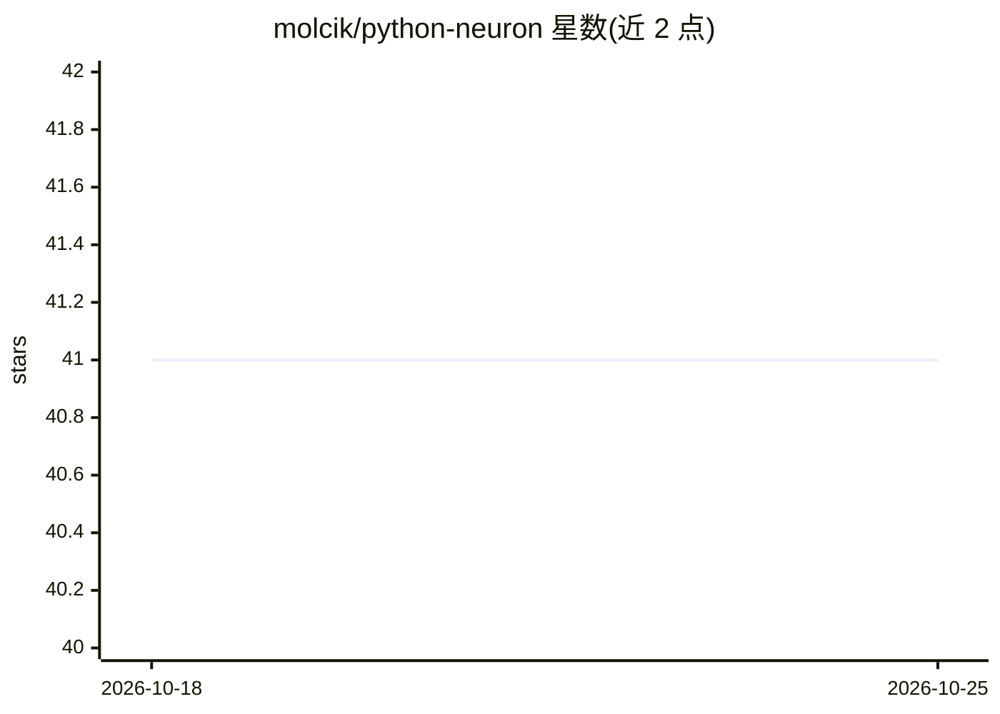

# molcik/python-neuron

⭐ 41 · Python · 推送 2026-01-06 · [GitHub](https://github.com/molcik/python-neuron) · [官网](http://filipmolcik.com/portfolio/artificial-neural-networks/) · 个人维护

**提供多种神经元模型的 Python 预测库**

Neuron class 提供 LNU、QNU、RBF、MLP、MLP-ELM 等神经元/神经网络类，通过梯度下降或 Levenberg–Marquardt 算法训练，用于时间序列预测等任务，train/count 接口返回预测值、权重与 MSE。依赖 pandas 和 numpy。README 仅给出各模型的代码用法示例，未给出安装命令（无 pip/克隆说明）。

## 筛选速览

| 维度 | 判定 | 备注 |
|---|---|---|
| AI 角色 | `ai-native` | 本体是模型或模型工具 |
| 许可风险 | `none` | — |
| 部署形态 | `None` |  |
| 模型依赖 | — | README 未给出锁定关系 |
| 硬件要求 | — | 无带数字的原话,不猜 |
| 安装摩擦 | `low` | 无编译、无系统依赖或容器化 |
| 成熟度 | — | 结构信号不足 |

## 能力要点

- LNU/QNU/RBF/MLP/MLP-ELM 多种神经元模型
- 梯度下降与 Levenberg–Marquardt 训练算法
- 支持 prediction 步长与学习窗口（MLPLMWL）参数

## 适用场景

- 时间序列预测任务的模型实验
- 对比不同神经元结构的预测效果

## 场景标签

 · 领域:机器学习/预测

## 证据(README 行号)

> L2: Neuron class provides LNU (Linear Neural Unit), QNU (Quadratic Neural Unit), RBF (Radial Basis Function), MLP (Multi
> L15: yn, w, e, Wall, MSE = neuron.train(Y_train, X_train, epochs=2, prediction=prediction)

## 星数曲线

2026-10-18 41 → 2026-10-25 41（+0）

---
*卡片 v1 · prompt 1.4 · 生成 2026-10-25 · 置信度 high · 依据 README sha `bdab0c12310b` · [字段定义](../../DATASET.md)*
