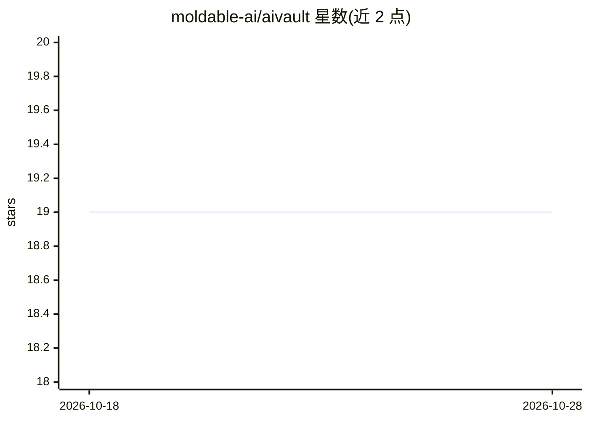

# moldable-ai/aivault

⭐ 19 · Rust · NOASSERTION · 推送 2026-09-11 · [GitHub](https://github.com/moldable-ai/aivault) · [官网](https://aivault.moldable.sh) · 组织维护

**面向 AI agent 的本地密钥保险库与策略代理运行时**

本地 vault 加 CLI 驱动的策略代理：密钥加密存于 vault，调用方（agent/技能代码）仅能通过 capability 调用已批准的上游请求，认证由 broker 在线注入，调用方全程接触不到密钥。内置 provider 注册表编译进二进制，按 vaultSecrets 名称自动将密钥钉扎到对应 provider 并自动预配凭证与 capability；支持 header/query/OAuth2/AWS SigV4 等多种认证策略，代理管道实施主机白名单、auth 头剥离、路径穿越拒绝等零信任策略。当前未提供网络 HTTP 代理守护进程，代理契约仅在 broker 运行时层实现。Rust broker 类型 + 本地 CLI 形态，需从源码构建。

## 筛选速览

| 维度 | 判定 | 备注 |
|---|---|---|
| AI 角色 | `ai-ecosystem` | LLM/agent 周边工具 |
| 许可风险 | `none` | NOASSERTION |
| 部署形态 | `library` | 以包/库形式分发 |
| 模型依赖 | — | README 未给出锁定关系 |
| 硬件要求 | — | 无带数字的原话,不猜 |
| 安装摩擦 | `low` | 无编译、无系统依赖或容器化 |
| 成熟度 | — | 结构信号不足 |

## 能力要点

- 密钥钉扎机制：注册表认领的密钥名（如 OPENAI_API_KEY）只能注入匹配 provider 主机的请求
- 代理管道安全属性：策略派生主机、broker 独占 auth 头、重定向剥离认证、默认仅接受 127.0.0.1
- 内置 provider 注册表覆盖 AI/通信/生产力/支付等类别，凭证与 capability 自动预配
- 支持 header/query/path/basic/OAuth2/aws-sigv4/hmac/mtls 等 10 种认证策略

## 适用场景

- 让不可信的 agent/插件代码调用 OpenAI 等上游 API 而不暴露密钥
- 对 agent 的上游调用施加速率限制与请求/响应体大小等策略
- 集中管理多 provider 的 API 密钥并轮换/审计

## 场景标签

`网络安全` · 领域:学习与行业

## 证据(README 行号)

> L5: `aivault` is a local vault + policy-enforced proxy runtime for AI workflows: secrets stay encrypted in the vault, an
> L31: With `aivault`, secrets are stored in the vault, not in the caller's environment. All calls proxy through the vault

## 星数曲线

2026-10-18 19 → 2026-10-28 19（+0）

---
*卡片 v1 · prompt 1.4 · 生成 2026-10-28 · 置信度 mid · 依据 README sha `0fb51f2b99d3` · [字段定义](../../DATASET.md)*
