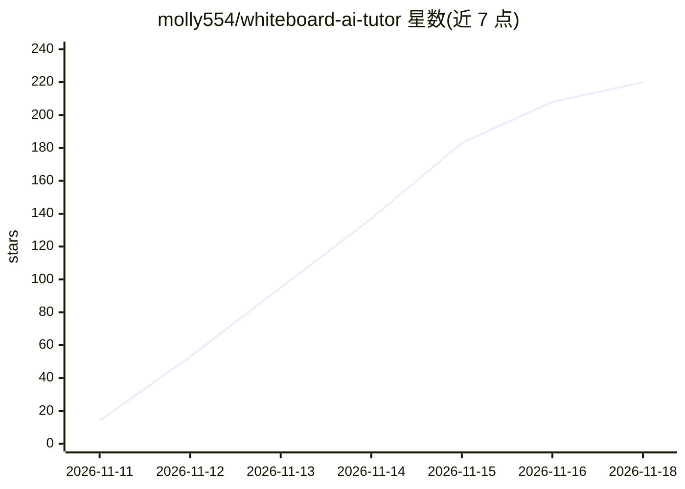

# molly554/whiteboard-ai-tutor

⭐ 220 · HTML · MIT · 推送 2026-11-17 · [GitHub](https://github.com/molly554/whiteboard-ai-tutor) · [官网](https://molly554.github.io/whiteboard-ai-tutor/) · 个人维护 · 中文 README

**白板 AI 导师参考实现与六大模型教学能力基准**

两部分组成：一是白板 AI 导师的参考实现——LLM 以冻结提示流式输出 JSON 绘图指令（write/line/rect/ellipse/path/erase 六种操作，1600×900 画板），浏览器播放器将其渲染为手写笔迹，支持学生打断并把画板状态回传模型；二是基准：同一提示、8 个场景、6 个模型、两种思考档位、共 288 次生成，64 个画板经盲审（外部评审模型按像素核验几何）。本仓库不是托管辅导应用，仅回放录制课程；生成新课需自带 API key 运行 benchmark runner。

## 筛选速览

| 维度 | 判定 | 备注 |
|---|---|---|
| AI 角色 | `ai-native` | 本体是模型或模型工具 |
| 许可风险 | `permissive` | MIT |
| 部署形态 | `library` | 以包/库形式分发 |
| 模型依赖 | locked-api |  |
| 硬件要求 | — | 无带数字的原话,不猜 |
| 安装摩擦 | `low` | 无编译、无系统依赖或容器化 |
| 成熟度 | — | 结构信号不足 |

## 能力要点

- 模型流式输出 JSON 绘图指令、播放器渲染为手写课程
- 学生打断后画板状态回传模型并继续作答
- 288 次生成、64 板盲审基准，附排行榜与成本/首笔延迟指标
- runner 钉定 OpenRouter 一方供应商、预算上限、可断点续跑

## 适用场景

- 在浏览器回放各模型的白板教学课程并对比效果
- 自带 API key 运行 runner 生成新的白板课程
- 研究 LLM 在图解教学场景下的几何准确性与成本权衡

## 场景标签

`模型评测` · 领域:评测与运维

## 证据(README 行号)

> L24: An AI tutor (or AI teacher) that writes, draws and erases on a whiteboard while it talks — and lets the student cut
> L30: - **A reference implementation** of that loop: the protocol, a whiteboard player, and a runner for Claude, Gemini a
> L32: - **A benchmark** of how well they teach: same prompt, same eight scenarios (science, maths, economics), six models

## 星数曲线

2026-11-11 14 → 2026-11-18 220（+206）

---
*卡片 v1 · prompt 1.4 · 生成 2026-11-17 · 置信度 high · 依据 README sha `639ea61496f7` · [字段定义](../../DATASET.md)*
