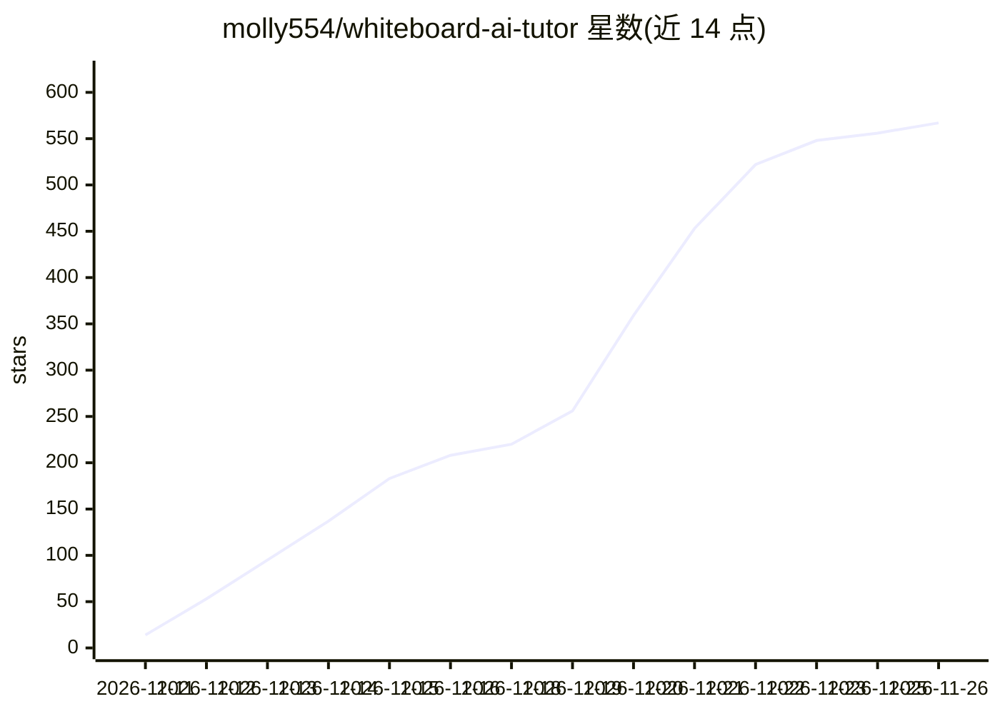

# molly554/whiteboard-ai-tutor

⭐ 567 · HTML · MIT · 推送 2026-11-24 · [GitHub](https://github.com/molly554/whiteboard-ai-tutor) · [官网](https://molly554.github.io/whiteboard-ai-tutor/) · 个人维护 · 中文 README

**在白板上边写边画的 AI 辅导应用与模型教学基准**

仓库包含两部分：一个白板教学循环的参考实现——模型以 JSON 流式输出绘图指令，浏览器播放器将其渲染为手写过程，学生可随时打断，应用把当前板书回传模型继续；以及一个教学能力基准——同一冻结提示词、8 个场景（科学/数学/经济）、6 个模型、288 次生成，产出 64 块经盲评的板书。播放器支持回放、PDF 导出与模型对比视图；生成新课需自备 API key 运行 runner。项目明确说明不是托管辅导应用。

## 筛选速览

| 维度 | 判定 | 备注 |
|---|---|---|
| AI 角色 | `ai-native` | 本体是模型或模型工具 |
| 许可风险 | `permissive` | MIT |
| 部署形态 | `library` | 以包/库形式分发 |
| 模型依赖 | locked-api |  |
| 硬件要求 | — | 无带数字的原话,不猜 |
| 安装摩擦 | `low` | 无编译、无系统依赖或容器化 |
| 成熟度 | — | 结构信号不足 |

## 能力要点

- 模型输出 6 种 JSON 操作（write/line/rect/ellipse/path/erase）渲染为白板手写动画
- 学生打断时将板书对象状态回传模型，模型仅回复新步骤
- 288 次运行、6 模型的盲评基准，64 块板书全部可回放
- 导出 A4 横向 PDF，无需 API key 或服务端服务

## 适用场景

- 回放并对比不同模型对同一问题的白板讲解
- 复现基准流程评估自己的模型
- 导出录制课程为 PDF 讲义

## 场景标签

`模型评测` · 领域:评测与运维

## 证据(README 行号)

> L3: **An open-source AI tutor that teaches on a whiteboard — and a benchmark of which LLM does it best.**
> L27: in — looks like a model capability. It isn't. It is a small protocol: the model streams drawing instructions as JSO
> L34: - **A benchmark** of how well they teach: same prompt, same eight scenarios (science, maths, economics), six models

## 星数曲线

2026-11-11 14 → 2026-11-26 567（+553）

---
*卡片 v1 · prompt 1.4 · 生成 2026-11-26 · 置信度 high · 依据 README sha `08fc3200c912` · [字段定义](../../DATASET.md)*
