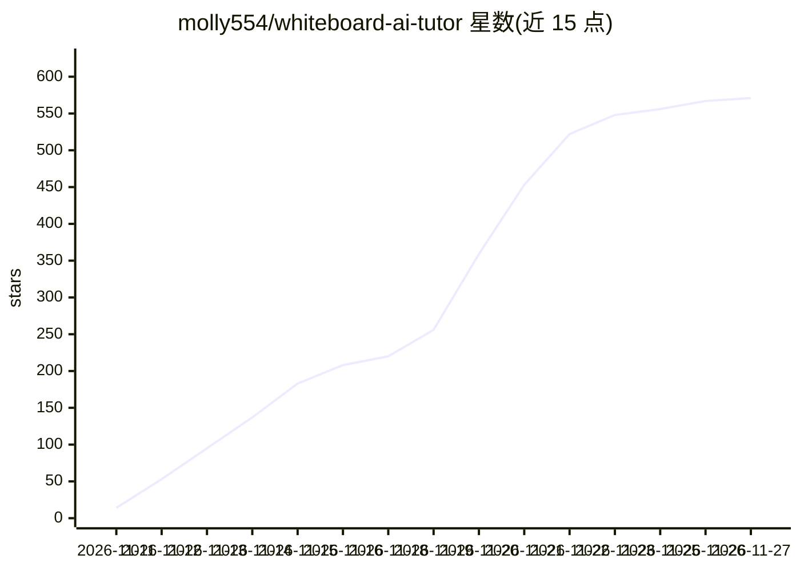

# molly554/whiteboard-ai-tutor

⭐ 571 · HTML · MIT · 推送 2026-11-26 · [GitHub](https://github.com/molly554/whiteboard-ai-tutor) · [官网](https://molly554.github.io/whiteboard-ai-tutor/) · 个人维护 · 中文 README

**在白板上边写边画的 AI 家教，附六模型教学效果基准**

项目包含两部分：一是「协议+播放器+运行器」的参考实现——LLM 按冻结提示词流式输出 JSON 绘图指令（write/line/rect/ellipse/path/erase 六种操作），浏览器播放器将其渲染为逐笔手写讲解，学生打断时把当前板书回传模型继续；二是基准评测——同一提示词、8 个场景、6 个模型、288 次生成、64 块盲评板书，附排行榜、自动指标与人工审计流程。播放器可回放课程并导出 PDF；生成新课程需自备 API key。提供中文协议提示词与评测方法文档。

## 筛选速览

| 维度 | 判定 | 备注 |
|---|---|---|
| AI 角色 | `ai-native` | 本体是模型或模型工具 |
| 许可风险 | `permissive` | MIT |
| 部署形态 | `library` | 以包/库形式分发 |
| 模型依赖 | locked-api |  |
| 硬件要求 | — | 无带数字的原话,不猜 |
| 安装摩擦 | `low` | 无编译、无系统依赖或容器化 |
| 成熟度 | — | 结构信号不足 |

## 能力要点

- 模型仅输出 JSON 绘图指令，播放器渲染为可打断的白板手写回放
- 288 次生成、64 块盲评板书的六模型教学基准与排行榜
- 打断机制：将板书对象（id/包围盒/文本）回传模型继续讲解
- 课程可导出 A4 横版 PDF，无需服务端

## 适用场景

- 给学生学习科学/数学/经济学概念的白板动画讲解
- 对比不同 LLM 在同一问题上的板书教学质量
- 复现或扩展白板教学协议的评测研究

## 场景标签

`模型评测` · 领域:评测与运维

## 证据(README 行号)

> L30: So any LLM can be the tutor. This repository is two things:
> L32: - **A reference implementation** of that loop: the protocol, a whiteboard player, and a runner for Claude, Gemini a
> L34: - **A benchmark** of how well they teach: same prompt, same eight scenarios (science, maths, economics), six models

## 星数曲线

2026-11-11 14 → 2026-11-27 571（+557）

---
*卡片 v1 · prompt 1.4 · 生成 2026-11-27 · 置信度 high · 依据 README sha `4159a4c95bd6` · [字段定义](../../DATASET.md)*
