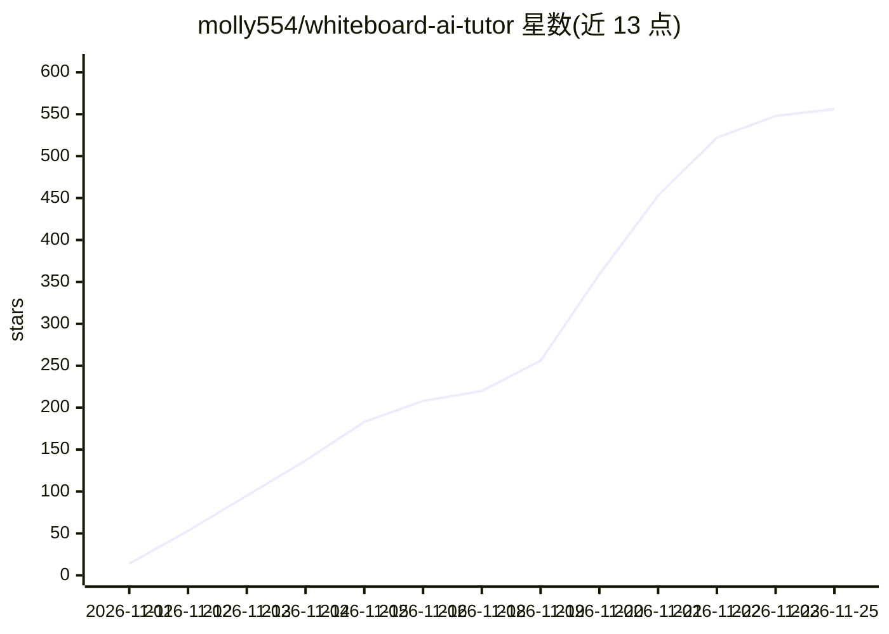

# molly554/whiteboard-ai-tutor

⭐ 556 · HTML · MIT · 推送 2026-11-23 · [GitHub](https://github.com/molly554/whiteboard-ai-tutor) · [官网](https://molly554.github.io/whiteboard-ai-tutor/) · 个人维护 · 中文 README

**白板 AI 家教：LLM 边写边画讲题，附六模型基准**

包含两部分：一是白板教学协议的参考实现——模型流式输出 JSON 绘图指令，浏览器播放器将其渲染为手写动画，学生可随时打断，应用把当前板面回传给模型继续作答；二是基准测试——固定提示词、8 个场景、6 个模型、288 次生成，64 块板经盲评打分，附排行榜与全部可回放结果。播放器无依赖即可本地回放；生成新课需自备 API key 运行 runner。

## 筛选速览

| 维度 | 判定 | 备注 |
|---|---|---|
| AI 角色 | `ai-native` | 本体是模型或模型工具 |
| 许可风险 | `permissive` | MIT |
| 部署形态 | `library` | 以包/库形式分发 |
| 模型依赖 | locked-api |  |
| 硬件要求 | — | 无带数字的原话,不猜 |
| 安装摩擦 | `low` | 无编译、无系统依赖或容器化 |
| 成熟度 | — | 结构信号不足 |

## 能力要点

- 模型只输出 JSON 操作指令（write/line/rect/ellipse/path/erase 六种），播放器渲染为手写动画
- 学生打断时把板面对象（id/类型/包围框/文本）回传模型继续生成
- 288 次生成、64 块盲评板的基准，附盲评方法、评分标准与人工审计页
- 回放画廊无需 API key 与依赖，python serve.py 本地即可查看

## 适用场景

- 回放六模型在几何、科学、经济学题上的白板讲解动画
- 研究者复现或扩展这一定时提示词的 LLM 教学基准
- 开发类似白板教学应用时参考其 JSON 协议与打断机制

## 场景标签

`模型评测` `AI 助手` · 领域:对话与助手

## 证据(README 行号)

> L3: **An open-source AI tutor that teaches on a whiteboard — and a benchmark of which LLM does it best.**
> L26: An AI tutor (or AI teacher) that writes, draws and erases on a whiteboard while it talks — and lets the student cut
> L34: - **A benchmark** of how well they teach: same prompt, same eight scenarios (science, maths, economics), six models

## 星数曲线

2026-11-11 14 → 2026-11-25 556（+542）

---
*卡片 v1 · prompt 1.4 · 生成 2026-11-25 · 置信度 high · 依据 README sha `35cbb32f16e3` · [字段定义](../../DATASET.md)*
