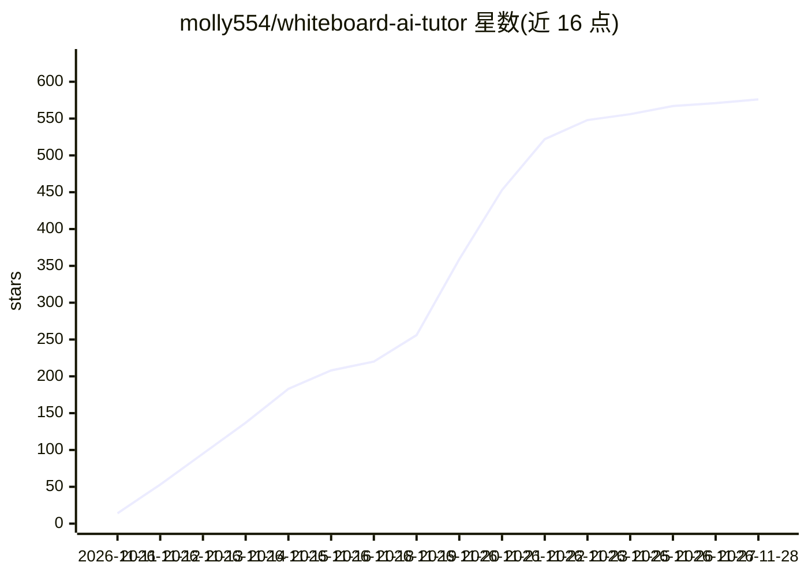

# molly554/whiteboard-ai-tutor

⭐ 576 · HTML · MIT · 推送 2026-11-27 · [GitHub](https://github.com/molly554/whiteboard-ai-tutor) · [官网](https://molly554.github.io/whiteboard-ai-tutor/) · 个人维护 · 中文 README

**开源白板 AI 教师：模型边讲边画，附六模型教学基准**

参考实现加基准两部分：模型以冻结提示词流式输出 JSON 绘制指令，浏览器播放器逐步回放为手写白板课程，学生可打断并回传板书状态；支持六种绘图操作与课程 PDF 导出。基准部分对 Claude、Gemini、DeepSeek 六模型在 8 个场景、两种思考设置、三次重复下共 288 次生成，64 块板书经盲审评分并给出排行榜。本地浏览结果无需 API key，生成新课程需自带 key。

## 筛选速览

| 维度 | 判定 | 备注 |
|---|---|---|
| AI 角色 | `ai-native` | 本体是模型或模型工具 |
| 许可风险 | `permissive` | MIT |
| 部署形态 | `library` | 以包/库形式分发 |
| 模型依赖 | locked-api |  |
| 硬件要求 | — | 无带数字的原话,不猜 |
| 安装摩擦 | `low` | 无编译、无系统依赖或容器化 |
| 成熟度 | — | 结构信号不足 |

## 能力要点

- 模型输出 JSON 指令、播放器渲染为可回放的白板课程，学生可打断
- 288 次生成、64 块盲审板书的模型对比基准与排行榜
- 课程导出为 A4 横版 PDF，含打断时的板书与提问
- 实验性 widget 操作：学生可拖动曲线并由代码判定答案

## 适用场景

- 观看/回放 AI 在白板上讲解数学、科学、经济学课程
- 对比同一问题下不同 LLM 的板书教学质量
- 复现基准或用自己的 API key 跑新的白板课程

## 场景标签

`模型评测` `AI 助手` · 领域:对话与助手

## 证据(README 行号)

> L3: **An open-source AI tutor that teaches on a whiteboard — and a benchmark of which LLM does it best.**
> L27: in — looks like a model capability. It isn't. It is a small protocol: the model streams drawing instructions as JSO
> L34: - **A benchmark** of how well they teach: same prompt, same eight scenarios (science, maths, economics), six models

## 星数曲线

2026-11-11 14 → 2026-11-28 576（+562）

---
*卡片 v1 · prompt 1.4 · 生成 2026-11-28 · 置信度 high · 依据 README sha `9fcd74e9abf7` · [字段定义](../../DATASET.md)*
