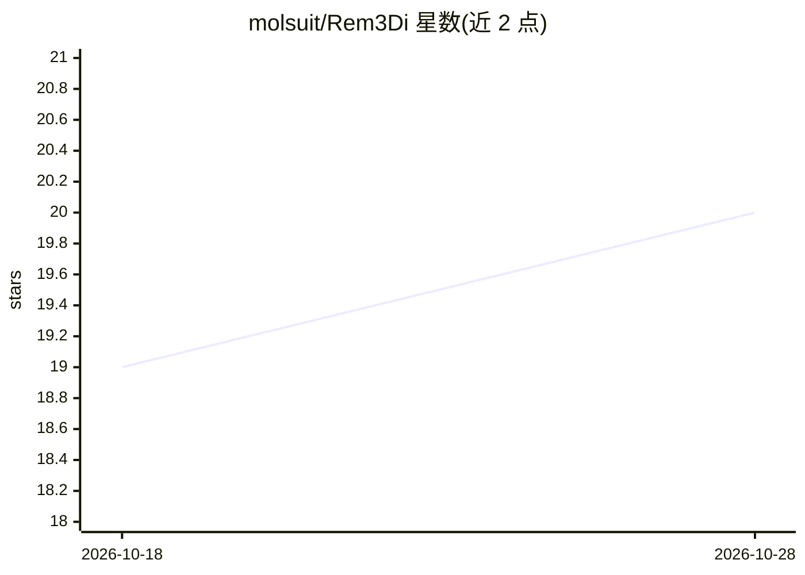

# molsuit/Rem3Di

⭐ 20 · Python · Apache-2.0 · 推送 2026-10-06 · [GitHub](https://github.com/molsuit/Rem3Di) · [官网](https://arxiv.org/abs/2607.19977) · 组织维护

**从原子级基础模型学习平滑手性 3D 分子表示的研究库**

Rem3Di 是基于等变原子间基础模型（MACE）学习平滑、手性 3D 分子表示的 Python 库，面向计算化学与材料科学研究者。提供 CPU 与 CUDA 两种安装通道，数据集以 zarr 数组存储以支持超出内存规模的多线程读取；包含数据集生成管线（构象采样、弛豫、MACE 描述符计算）、去噪预训练脚本与下游回归头训练流程。配套论文首发于 NeurIPS 2025 Workshop on Symmetry and Geometry in Neural Representations。要求 Python >=3.12。

## 筛选速览

| 维度 | 判定 | 备注 |
|---|---|---|
| AI 角色 | `ai-native` | 本体是模型或模型工具 |
| 许可风险 | `permissive` | Apache-2.0 |
| 部署形态 | `library` | 以包/库形式分发 |
| 模型依赖 | — | README 未给出锁定关系 |
| 硬件要求 | — | 无带数字的原话,不猜 |
| 安装摩擦 | `medium` | 含编译或系统依赖之一 |
| 成熟度 | — | 结构信号不足 |

## 能力要点

- 从 MACE 等变基础模型提取分子描述符
- zarr 数组支撑超出内存的数据集多线程读取
- 批量数据集生成管线（构象采样/弛豫/描述符计算）
- 去噪预训练与下游回归训练脚本

## 适用场景

- 为分子性质预测生成 3D 表示/描述符
- 在 Geom Drugs 等数据集上训练下游回归模型
- 从 SMILES 或 ASE 原子结构批量构建嵌入数据集

## 场景标签

 · 领域:计算化学/材料科学

## 证据(README 行号)

> L1: # Rem3Di: REpresentation learning for Molecules with 3D Information
> L3:  Learning smooth, chiral 3D molecular representations from equivariant atomistic foundation models
> L28: uv pip install "remedi[cpu]"    # PyTorch + MACE, CPU descriptors

## 星数曲线

2026-10-18 19 → 2026-10-28 20（+1）

---
*卡片 v1 · prompt 1.4 · 生成 2026-10-28 · 置信度 high · 依据 README sha `88ee4644d780` · [字段定义](../../DATASET.md)*
