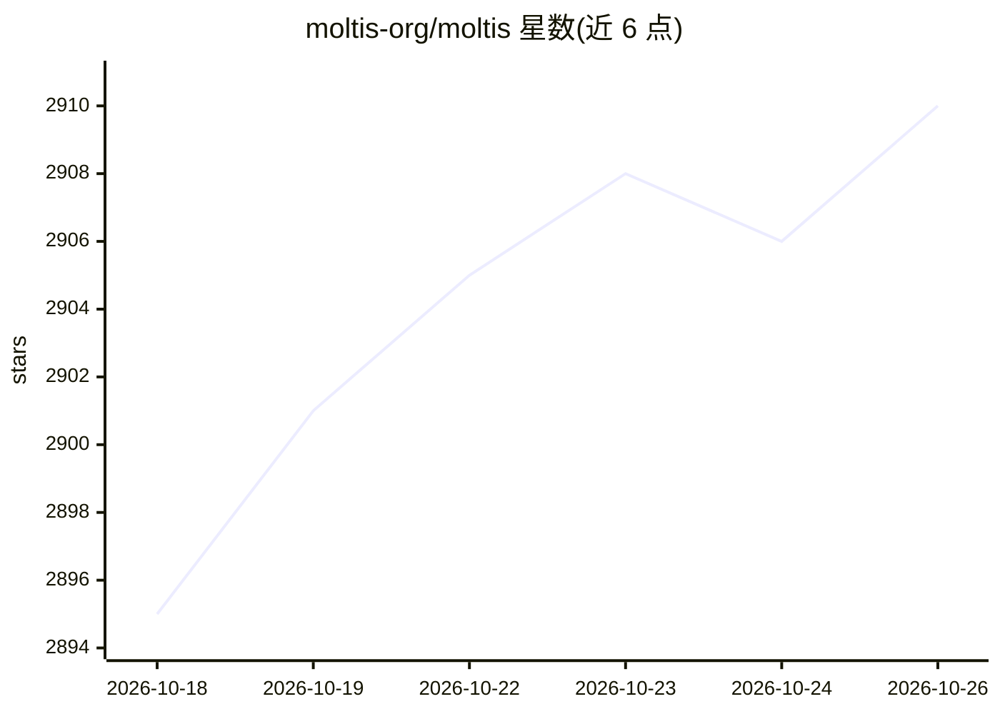

# moltis-org/moltis

⭐ 2,910 · Rust · MIT · 推送 2026-10-23 · [GitHub](https://github.com/moltis-org/moltis) · [官网](https://moltis.org) · 组织维护

**Rust 单二进制自托管个人 AI agent 服务器**

以单个 Rust 二进制运行的本地优先持久 agent 服务器：作为网关接入多 LLM 提供商（OpenAI Codex、GitHub Copilot、本地模型），通过 Web UI、桌面客户端及 Telegram/Discord/Signal/Teams 等渠道与用户交互。每条命令在 Docker/Podman/Apple Container 沙箱中执行，内置向量+全文记忆、MCP 工具（stdio 与 HTTP/SSE）、语音 I/O、定时任务与密钥保险库。面向在自己硬件上自托管的个人用户，MIT 许可。限制：自建源码需 just 与 Node.js 构建前端样式。

## 筛选速览

| 维度 | 判定 | 备注 |
|---|---|---|
| AI 角色 | `ai-native` | 本体是模型或模型工具 |
| 许可风险 | `permissive` | MIT |
| 部署形态 | `self-host` | docker 或自建部署 |
| 模型依赖 | — | README 未给出锁定关系 |
| 硬件要求 | — | 无带数字的原话,不猜 |
| 安装摩擦 | `low` | 无编译、无系统依赖或容器化 |
| 成熟度 | — | 结构信号不足 |

## 能力要点

- 单 Rust 二进制，59 个 workspace crate 模块化架构
- 多 LLM 提供商接入与流式 agent 循环、子 agent 委派
- 命令沙箱执行（Docker/Podman/Apple Container/WASM）
- SQLite+FTS+向量记忆、跨会话召回与自动编辑检查点

## 适用场景

- 在自有服务器/Mac Mini/树莓派上运行个人 AI 助手
- 通过 Telegram、Discord 等消息渠道随时与 agent 对话
- 以沙箱隔离方式让 agent 执行命令与文件操作

## 场景标签

`AI 助手` `语音 Agent` · 领域:对话与助手

## 证据(README 行号)

> L125: Moltis is a **local-first persistent agent server** — a single Rust binary that
> L111: - **AI Gateway** — Multi-provider LLM support (OpenAI Codex, GitHub Copilot, Local), streaming responses, agent lo

## 星数曲线

2026-10-18 2,895 → 2026-10-26 2,910（+15）

---
*卡片 v1 · prompt 1.4 · 生成 2026-10-21 · 置信度 high · 依据 README sha `4a265f773ba4` · [字段定义](../../DATASET.md)*
