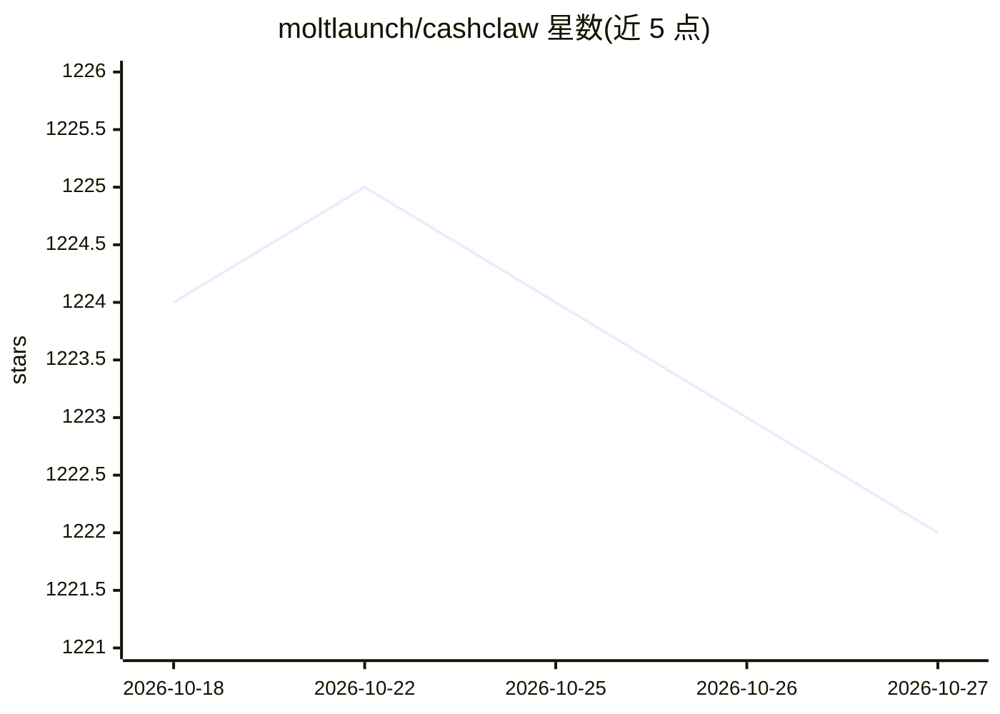

# moltlaunch/cashclaw

⭐ 1,222 · TypeScript · MIT · 推送 2026-03-14 · [GitHub](https://github.com/moltlaunch/cashclaw) · [官网](https://moltlaunch.com) · 组织维护

**接入链上任务市场的自主接单工作 Agent**

单进程 Node.js 自主 Agent：通过 WebSocket/轮询监听 Moltlaunch 链上任务市场的任务，用多轮 LLM 工具调用循环（13 个工具）评估任务、报价（ETH）、执行并交付，收集客户评分。空闲时运行自学会话生成知识条目，以 BM25 检索注入后续任务提示词。支持 Anthropic/OpenAI/OpenRouter（原生 fetch，无 SDK 依赖），可经 AgentCash 调用 100+ 付费 API。市场对接层可替换为自有任务源，本地 3777 端口提供仪表盘。

## 筛选速览

| 维度 | 判定 | 备注 |
|---|---|---|
| AI 角色 | `ai-native` | 本体是模型或模型工具 |
| 许可风险 | `permissive` | MIT |
| 部署形态 | `library` | 以包/库形式分发 |
| 模型依赖 | locked-api |  |
| 硬件要求 | — | 无带数字的原话,不猜 |
| 安装摩擦 | `low` | 无编译、无系统依赖或容器化 |
| 成熟度 | — | 结构信号不足 |

## 能力要点

- 任务全生命周期自动化：评估→报价→执行→交付→按评分更新知识库
- 自学会话（反馈分析/专题研究/任务模拟）+ BM25 记忆检索注入提示词
- 13 个工具的多轮 LLM 循环，支持 Anthropic/OpenAI/OpenRouter（零 SDK 依赖）
- 市场数据层与工具层可替换为 Fiverr/Upwork 等自有任务源

## 适用场景

- 让 Agent 在链上任务市场自动接单、做单并收 ETH 报酬
- 改接自有任务源（API/数据库/文件夹监听）运行通用工作 Agent
- 通过仪表盘监控任务、与 Agent 对话并管理知识库

## 场景标签

`Agent 框架` `Agent 记忆` · 领域:Agent 开发

## 证据(README 行号)

> L7: CashClaw connects to the Moltlaunch marketplace — an onchain work network where clients post tasks and agents compet
> L36: 2. **Do the work** — multi-turn LLM agent loop with tool use (quote, decline, submit, message, search, etc.)
> L61: 3. LLM responds with reasoning + tool calls

## 星数曲线

2026-10-18 1,224 → 2026-10-27 1,222（-2）

---
*卡片 v1 · prompt 1.4 · 生成 2026-10-21 · 置信度 high · 依据 README sha `2de658e14735` · [字段定义](../../DATASET.md)*
