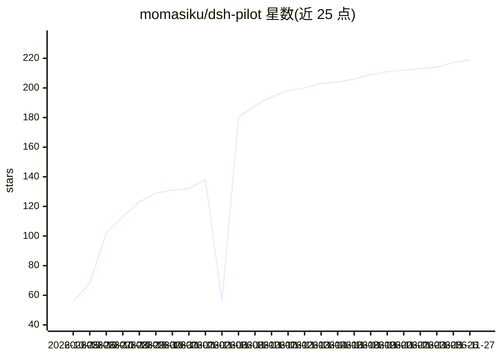

# momasiku/dsh-pilot

⭐ 219 · JavaScript · MIT · 推送 2026-11-26 · [GitHub](https://github.com/momasiku/dsh-pilot) · [官网](https://www.npmjs.com/package/@momasiku/dsh-pilot) · 个人维护 · 中文 README

**给 DeepSeek Harness 提供屏幕截图与键鼠操控工具的 Windows 插件**

dsh-pilot 是 DeepSeek Harness（DSH）的插件，在 Windows 上向模型暴露三个工具：screen_view（抓屏并作为图像块连同坐标刻度尺交付）、desktop_control（鼠标/键盘/窗口操作与 UI Automation 控件树读取）、desktop_sequence（一次调用执行整串动作）。通过常驻 PowerShell worker、帧哈希去重、per-monitor DPI 感知与坐标契约来降低模型与电脑的往返次数和坐标偏差；提供风险声明、dryRun、遇错即停、Esc 中断等安全机制。要求 DSH 0.1.5-rc.2 至 0.2.x、PowerShell 5.1 或 7，经 npm 安装。

## 筛选速览

| 维度 | 判定 | 备注 |
|---|---|---|
| AI 角色 | `ai-ecosystem` | LLM/agent 周边工具 |
| 许可风险 | `permissive` | MIT |
| 部署形态 | `None` |  |
| 模型依赖 | locked-api |  |
| 硬件要求 | — | 无带数字的原话,不猜 |
| 安装摩擦 | `low` | 无编译、无系统依赖或容器化 |
| 成熟度 | — | 结构信号不足 |

## 能力要点

- screen_view 将真实截图作为图像块交付，附带屏幕坐标刻度尺与缩放说明
- desktop_sequence 单次调用执行整串动作，减少模型↔电脑往返
- 通过 Windows UI Automation 读取控件树，提供精确矩形与控件状态
- 风险分级声明、dryRun、遇错即停与 Esc 取消令牌等安全机制

## 适用场景

- 让 DSH 模型在 AutoCAD 命令行里逐步绘图
- 通过模型自动完成 WPS/浏览器/桌面应用的点击与输入操作
- 需要模型直接看到真实屏幕像素并驱动鼠标键盘的桌面自动化

## 场景标签

`GUI 自动化` · 领域:效率与自动化

## 证据(README 行号)

> L1: dsh-pilot — desktop control for DeepSeek Harness: hands and eyes on the whole machine
> L20: > **给 DeepSeek Harness 装上眼睛和手——装在整个桌面上。**
> L159: 要求 DSH **0.1.5-rc.2 至 0.2.x**（即 `package.json` 里的 peer 范围，也是 `dsh plugin add` 在安装前的门禁）。环境要求：**Windows**、PowerShell

## 星数曲线

2026-10-25 56 → 2026-11-27 219（+163）

---
*卡片 v1 · prompt 1.4 · 生成 2026-11-26 · 置信度 high · 依据 README sha `3bf3bfcbf70d` · [字段定义](../../DATASET.md)*
