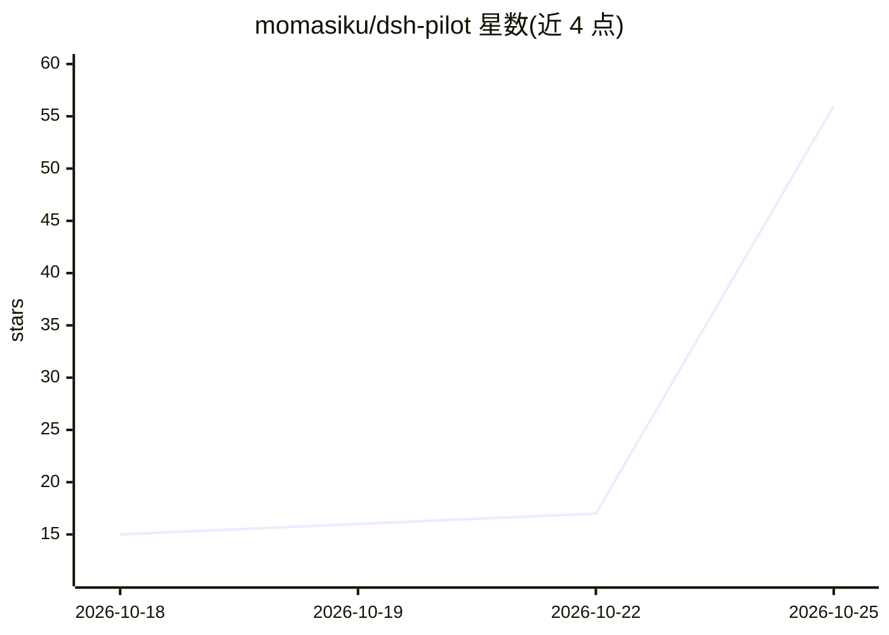

# momasiku/dsh-pilot

⭐ 68 · JavaScript · MIT · 推送 2026-10-25 · [GitHub](https://github.com/momasiku/dsh-pilot) · [官网](https://www.npmjs.com/package/@momasiku/dsh-pilot) · 个人维护 · 中文 README

**给 DeepSeek Harness 装 Windows 桌面操控能力的插件**

dsh-pilot 是 DeepSeek Harness（DSH）的桌面操控插件：提供 screen_view 抓屏（PNG 图像块，附坐标刻度尺）、desktop_control 单步动作、desktop_sequence 批量动作三个工具，让模型直接看真实屏幕并驱动真实鼠标键盘。坐标可靠性通过 per-monitor DPI 感知、刻度尺与交付尺寸声明实现；支持 UI Automation 控件树作为截图之外的定位路径。安全机制包括风险分级拒绝、dryRun、遇错即停、Esc 中断与批量步数上限。环境要求 Windows、PowerShell 5.1/7、DSH 0.1.5-rc.2 至 0.2.x 及支持图像输入的模型线路。面向在 DSH 上运行桌面自动化 agent 的用户，以 npm 包 @momasiku/dsh-pilot 安装。

## 筛选速览

| 维度 | 判定 | 备注 |
|---|---|---|
| AI 角色 | `ai-ecosystem` | LLM/agent 周边工具 |
| 许可风险 | `permissive` | MIT |
| 部署形态 | `None` |  |
| 模型依赖 | locked-api |  |
| 硬件要求 | — | 无带数字的原话,不猜 |
| 安装摩擦 | `low` | 无编译、无系统依赖或容器化 |
| 成熟度 | — | 结构信号不足 |

## 能力要点

- screen_view 返回真实 PNG 图像块并附屏幕坐标刻度尺
- desktop_sequence 一次调用执行批量动作，常驻 worker 下动作延迟 6-12 毫秒
- 通过 UI Automation 读控件树，按精确矩形定位控件
- 风险分级、dryRun、遇错即停、Esc 中断等安全机制

## 适用场景

- 让 DSH 会话自己看屏幕、点按钮、打字完成桌面任务
- 在 AutoCAD/LibreOffice/Blender 等软件里由模型执行操作
- 用控件树精确定位界面元素替代像素猜测

## 场景标签

`GUI 自动化` · 领域:效率与自动化

## 证据(README 行号)

> L1: dsh-pilot — desktop control for DeepSeek Harness: hands and eyes on the whole machine
> L44: |**`screen_view`**|抓取当前屏幕，把 PNG 作为**真正的图像块**交给模型（不是 OCR、不是文字描述），连光标位置、前台窗口、各显示器范围一起给出|
> L159: 要求 DSH **0.1.5-rc.2 至 0.2.x**（即 `package.json` 里的 peer 范围，也是 `dsh plugin add` 在安装前的门禁）。环境要求：**Windows**、PowerShell

## 星数曲线

2026-10-18 15 → 2026-10-25 56（+41）

---
*卡片 v1 · prompt 1.4 · 生成 2026-10-24 · 置信度 high · 依据 README sha `aba0d10b4717` · [字段定义](../../DATASET.md)*
