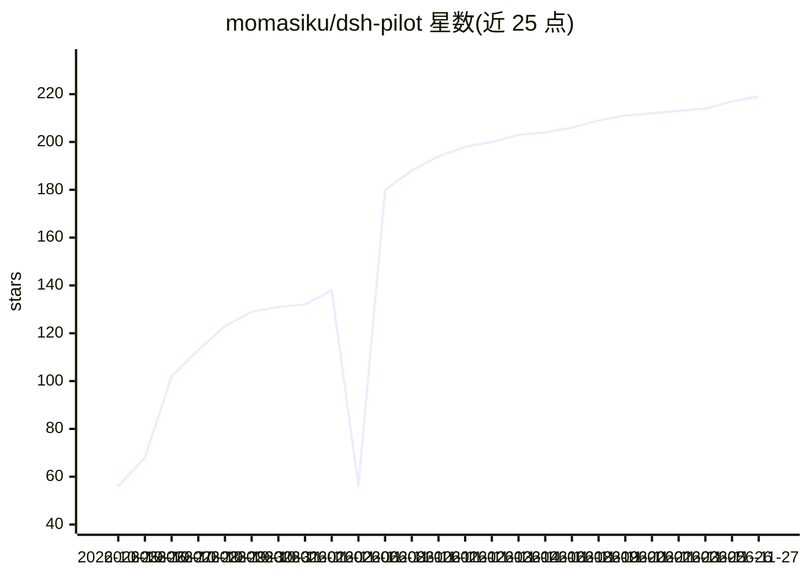

# momasiku/dsh-pilot

⭐ 219 · JavaScript · MIT · 推送 2026-11-26 · [GitHub](https://github.com/momasiku/dsh-pilot) · [官网](https://www.npmjs.com/package/@momasiku/dsh-pilot) · 个人维护 · 中文 README

**给 DeepSeek Harness 增加 Windows 桌面操控能力的插件**

以 DSH 插件形式分发（npm scoped 包），为 DeepSeek Harness 提供 screen_view、desktop_control、desktop_sequence 三个工具：截图以图像块交给模型，执行鼠标/键盘/窗口操作，并支持一次调用串行多步动作以减少往返。通过 UI Automation 控件树提供精确坐标的替代路径，带坐标刻度尺、DPI 感知、风险等级前置拦截、dryRun、Esc 中断等机制。要求 Windows、PowerShell 5.1/7、DSH 0.1.5-rc.2 至 0.2.x，以及声明图像输入的模型线路。

## 筛选速览

| 维度 | 判定 | 备注 |
|---|---|---|
| AI 角色 | `ai-ecosystem` | LLM/agent 周边工具 |
| 许可风险 | `permissive` | MIT |
| 部署形态 | `None` |  |
| 模型依赖 | locked-api |  |
| 硬件要求 | — | 无带数字的原话,不猜 |
| 安装摩擦 | `low` | 无编译、无系统依赖或容器化 |
| 成熟度 | — | 结构信号不足 |

## 能力要点

- 三个工具：屏幕截图、鼠标键盘控制、多步动作批处理
- UI Automation 控件树读取，提供像素之外的精确点击路径
- 风险等级前置拦截、dryRun、Esc 取消令牌等安全机制
- 常驻 PowerShell worker 降低动作延迟，frameHash 去重截图

## 适用场景

- 让 DSH agent 直接操作 AutoCAD、LibreOffice、Blender 等桌面软件
- 自动化浏览器操作、发微信等日常桌面任务
- 通过模型驱动真实鼠标键盘完成 Windows GUI 自动化

## 场景标签

`GUI 自动化` · 领域:效率与自动化

## 证据(README 行号)

> L1: dsh-pilot — desktop control for DeepSeek Harness: hands and eyes on the whole machine
> L44: |**`screen_view`**|抓取当前屏幕，把 PNG 作为**真正的图像块**交给模型（不是 OCR、不是文字描述），连光标位置、前台窗口、各显示器范围一起给出|
> L159: 要求 DSH **0.1.5-rc.2 至 0.2.x**（即 `package.json` 里的 peer 范围，也是 `dsh plugin add` 在安装前的门禁）。环境要求：**Windows**、PowerShell

## 星数曲线

2026-10-25 56 → 2026-11-27 219（+163）

---
*卡片 v1 · prompt 1.4 · 生成 2026-11-27 · 置信度 high · 依据 README sha `dcfa039f198b` · [字段定义](../../DATASET.md)*
