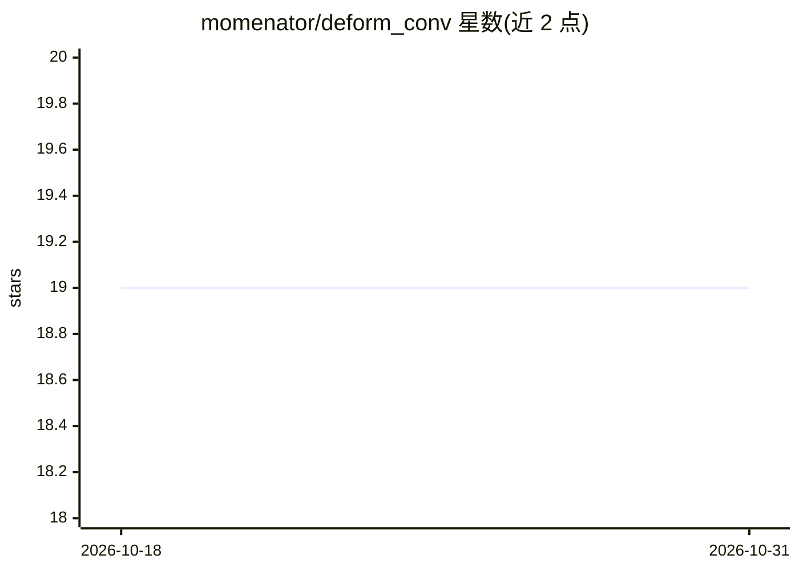

# momenator/deform_conv

⭐ 19 · Python · MIT · 推送 2026-06-05 · [GitHub](https://github.com/momenator/deform_conv) · 个人维护

**PyTorch 2D/3D 可变形卷积层实现库，供深度学习开发者使用**

以 PyTorch 实现 arXiv:1703.06211 论文定义的可变形卷积，提供 2D 与 3D 输入的卷积层，偏移场为可学习参数。支持以模块导入（deform_conv3d、ConvOffset2D、ConvOffset3D）方式嵌入网络。依赖 Python>=3.8、PyTorch>=1.7.0、NumPy>=1.19.0，通过 git clone 从源码安装，另提供开发依赖安装与 pytest 测试流程，MIT 许可。

## 筛选速览

| 维度 | 判定 | 备注 |
|---|---|---|
| AI 角色 | `ai-native` | 本体是模型或模型工具 |
| 许可风险 | `permissive` | MIT |
| 部署形态 | `library` | 以包/库形式分发 |
| 模型依赖 | — | README 未给出锁定关系 |
| 硬件要求 | — | 无带数字的原话,不猜 |
| 安装摩擦 | `low` | 无编译、无系统依赖或容器化 |
| 成熟度 | — | 结构信号不足 |

## 能力要点

- 2D 与 3D 可变形卷积层，带可学习偏移场
- 实现 arXiv:1703.06211 论文方法
- 提供包级导入接口 deform_conv3d / ConvOffset2D / ConvOffset3D

## 适用场景

- 在 PyTorch 网络中替换标准卷积为可变形卷积
- 复现或实验 3D 输入上的可变形卷积
- 基于该层构建几何形变敏感的视觉模型

## 场景标签

 · 领域:计算机视觉/深度学习库

## 证据(README 行号)

> L3: PyTorch implementation of deformable convolution layers for 2D and 3D inputs with learnable offset fields.
> L28: from deformable_conv_3d import deform_conv3d

## 星数曲线

2026-10-18 19 → 2026-10-31 19（+0）

---
*卡片 v1 · prompt 1.4 · 生成 2026-10-28 · 置信度 mid · 依据 README sha `285d12ab0770` · [字段定义](../../DATASET.md)*
