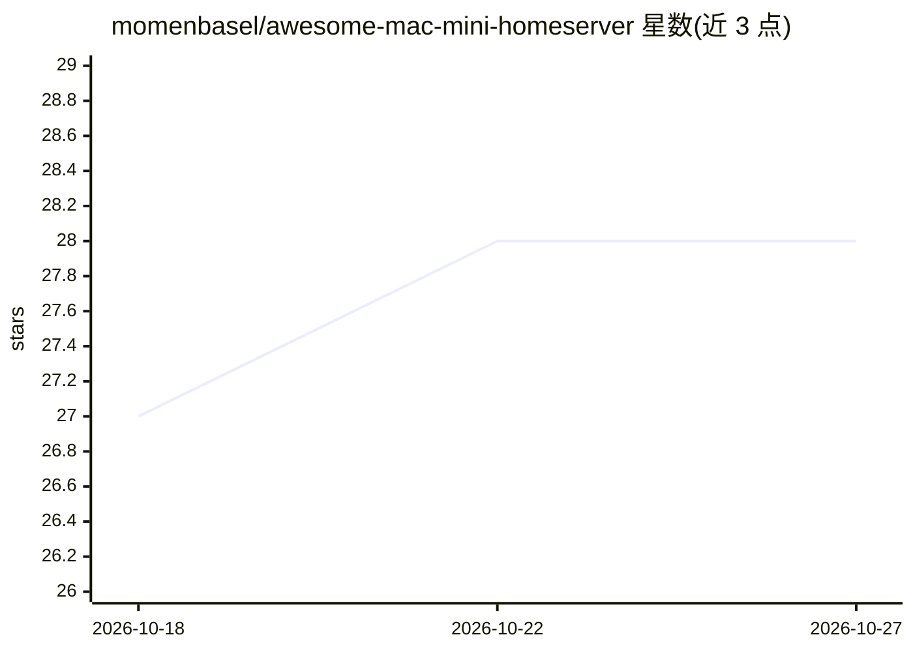

# momenbasel/awesome-mac-mini-homeserver

⭐ 28 · Shell · NOASSERTION · 推送 2026-08-09 · [GitHub](https://github.com/momenbasel/awesome-mac-mini-homeserver) · [官网](https://momenbasel.github.io/awesome-mac-mini-homeserver/) · 个人维护

**Mac mini 家庭服务器与本地 agentic AI 工具策展清单（260+ 条）**

面向 Apple Silicon Mac mini 用户与自托管爱好者的 awesome 清单：收录 260+ 条工具、指南与项目，按 Agentic AI（本地 LLM 运行时、agent 框架、编码 agent）、媒体服务器（Jellyfin/Sonarr 等）、自托管应用（Vaultwarden/Gitea 等）组织。提供 install.sh 一键安装脚本，可非交互安装整套 stack（Agentic/Media/Selfhosted/all），并用徽章标注 Apple Silicon/Intel/Docker 等兼容性。条目本身为工具索引，需另行安装各工具。

## 筛选速览

| 维度 | 判定 | 备注 |
|---|---|---|
| AI 角色 | `ai-knowledge` | 知识聚合/清单类 |
| 许可风险 | `none` | NOASSERTION |
| 部署形态 | `self-host` | docker 或自建部署 |
| 模型依赖 | — | README 未给出锁定关系 |
| 硬件要求 | — | 无带数字的原话,不猜 |
| 安装摩擦 | `low` | 无编译、无系统依赖或容器化 |
| 成熟度 | — | 结构信号不足 |

## 能力要点

- install.sh 一键安装脚本，支持 agentic/media/selfhosted/all 四种 stack
- 按 Agentic AI、媒体服务器、自托管应用分类组织 260+ 条工具
- 徽章体系标注 Apple Silicon/Intel/Universal、Native/Docker、Paid 兼容性
- 附带 Time Machine 服务器配置脚本与 LLM 内存选型文档

## 适用场景

- 把 Mac mini 改造成 24/7 本地 AI 与自托管服务器
- 查找适配 Apple Silicon 的本地 LLM 运行时与 agent 框架
- 一键搭建媒体服务器或密码库等自托管服务

## 场景标签

`精选清单` · 领域:学习与行业

## 证据(README 行号)

> L12:  A curated list of tools, guides, and projects for running an Apple Silicon Mac mini as a 24/7 home server, with ag
> L149: ## Agentic AI

## 星数曲线

2026-10-18 27 → 2026-10-27 28（+1）

---
*卡片 v1 · prompt 1.4 · 生成 2026-10-26 · 置信度 mid · 依据 README sha `b29a75a2ab8c` · [字段定义](../../DATASET.md)*
