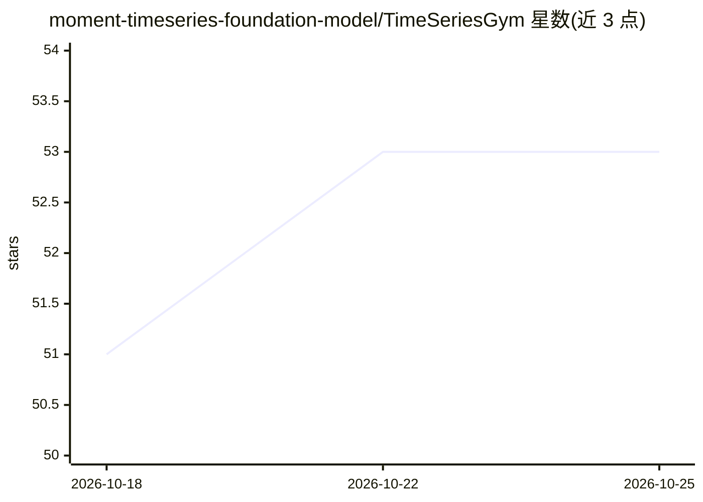

# moment-timeseries-foundation-model/TimeSeriesGym

⭐ 53 · Python · MIT · 推送 2026-10-17 · [GitHub](https://github.com/moment-timeseries-foundation-model/TimeSeriesGym) · 组织维护

**面向时间序列 ML 工程 Agent 的评测基准（33 项挑战）**

评测 AI agent 在时间序列机器学习工程任务上表现的基准框架：收录 33 项挑战，来自 23 个数据源、8 类时间序列问题、覆盖 15+ 领域，任务包括数据预处理、模型选型调参、研究代码利用、框架间代码迁移与特征工程。提供 CLI 完成数据集准备（prepare）与多维度评分（grade/grade-code/LLM-as-a-judge 的 evaluate-reasonableness），并附 Docker 环境用于可复现的 agent 执行与评测。支持 AIDE、ResearchAgent、OpenHands 等 agent 框架接入，基于 MLE-Bench 代码构建。Kaggle 数据需接受比赛规则，使用固定版本 kaggle==1.6.17。有配套论文，出自高校研究团队。

## 筛选速览

| 维度 | 判定 | 备注 |
|---|---|---|
| AI 角色 | `ai-ecosystem` | LLM/agent 周边工具 |
| 许可风险 | `permissive` | MIT |
| 部署形态 | `self-host` | docker 或自建部署 |
| 模型依赖 | — | README 未给出锁定关系 |
| 硬件要求 | — | 无带数字的原话,不猜 |
| 安装摩擦 | `low` | 无编译、无系统依赖或容器化 |
| 成熟度 | — | 结构信号不足 |

## 能力要点

- 33 项挑战、23 个数据源、8 类时间序列问题、15+ 领域
- CLI 覆盖数据准备、提交评分、超参搜索评估与代码评分
- LLM-as-a-judge 检测代码是否为真实建模尝试（需 OPENAI_API_KEY）
- Docker 环境支持可复现的 agent 执行与评测，含精简版 Lite 挑战集

## 适用场景

- 评测时间序列 ML 工程 agent 的端到端能力
- 用 Lite 子集做低成本快速评估
- 在统一环境中对比不同 agent 框架的表现

## 场景标签

`模型评测` · 领域:评测与运维

## 证据(README 行号)

> L8: TimeSeriesGym is a comprehensive benchmarking framework for evaluating AI agents on time series machine learning eng
> L216: ## Agent Integration
> L238: We would like to thank the authors of MLE-Bench for providing an excellent code repository that we could build on.

## 星数曲线

2026-10-18 51 → 2026-10-25 53（+2）

---
*卡片 v1 · prompt 1.4 · 生成 2026-10-24 · 置信度 high · 依据 README sha `4db763e5137d` · [字段定义](../../DATASET.md)*
