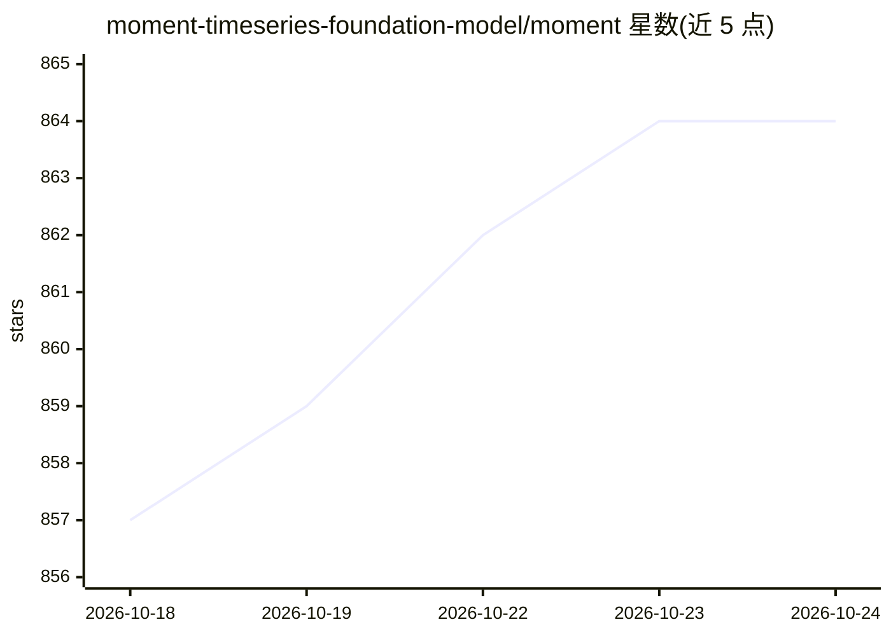

# moment-timeseries-foundation-model/moment

⭐ 864 · TypeScript · MIT · 推送 2026-02-10 · [GitHub](https://github.com/moment-timeseries-foundation-model/moment) · [官网](https://moment-timeseries-foundation-model.github.io/) · 组织维护

**开源时间序列基础模型：一个模型处理预测、分类、异常检测与补全**

CMU Auton Lab 发布的通用时间序列基础模型家族（ICML 2024 论文），基于 Time-series Pile 多数据集预训练，单一 Transformer 模型可零样本或少样本执行预测、分类、异常检测、数据补全与表示学习五类任务。提供 momentfm Python 包，经 Hugging Face 加载预训练权重，附各任务教程与 ECG 实战案例；实验可在单张 NVIDIA A6000（48 GiB）上复现，另放出完整研究代码用于自行预训练。推荐 Python 3.11。

## 筛选速览

| 维度 | 判定 | 备注 |
|---|---|---|
| AI 角色 | `ai-native` | 本体是模型或模型工具 |
| 许可风险 | `permissive` | MIT |
| 部署形态 | `library` | 以包/库形式分发 |
| 模型依赖 | — | README 未给出锁定关系 |
| 硬件要求 | — | 无带数字的原话,不猜 |
| 安装摩擦 | `low` | 无编译、无系统依赖或容器化 |
| 成熟度 | — | 结构信号不足 |

## 能力要点

- 单一模型覆盖预测/分类/异常检测/补全/表示学习五类任务
- 基于 Time-series Pile 大规模多数据集预训练
- 提供 momentfm pip 包与 Hugging Face 预训练权重
- 放出研究代码支持用自有数据预训练与复现论文实验

## 适用场景

- 用少量数据对时间序列做预测或分类
- 时间序列异常检测与缺失值补全
- 提取时间序列嵌入表示用于下游任务
- 基于自有数据预训练自己的时间序列基础模型

## 场景标签

`模型训练` · 领域:训练与推理

## 证据(README 行号)

> L19: We introduce MOMENT, a family of open-source foundation models for general-purpose time-series analysis. Pre-traini
> L25: MOMENT on different datasets and tasks, without any parameter updates:

## 星数曲线

2026-10-18 857 → 2026-10-24 864（+7）

---
*卡片 v1 · prompt 1.4 · 生成 2026-10-21 · 置信度 high · 依据 README sha `5d24a00c2334` · [字段定义](../../DATASET.md)*
