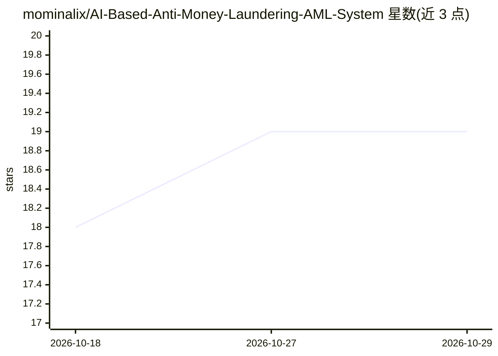

# mominalix/AI-Based-Anti-Money-Laundering-AML-System

⭐ 19 · Python · Apache-2.0 · 推送 2026-09-07 · [GitHub](https://github.com/mominalix/AI-Based-Anti-Money-Laundering-AML-System) · 个人维护

**面向开发者的可解释反洗钱监测参考平台**

Apache-2.0 的 AML 工程参考平台：将客户、账户与交易记录转换为可溯源的风险指标、调查员告警与可选的 AI 叙述草稿。混合方案由透明规则、自适应金额基线与时序支付网络信号组成，评分路径为本地计算，不依赖模型调用；可选接入 OpenAI Responses API 生成告警叙述草稿（默认关闭，默认为确定性模板），草稿需人工复核且不自动申报。技术栈为 Python/FastAPI、SQLite、RabbitMQ、NetworkX，提供 Docker Compose 启动与预览/批处理两条路径。README 声明其为可测试的工程参考，非经验证的生产 AML 系统。

## 筛选速览

| 维度 | 判定 | 备注 |
|---|---|---|
| AI 角色 | `ai-native` | 本体是模型或模型工具 |
| 许可风险 | `permissive` | Apache-2.0 |
| 部署形态 | `desktop` | 安装包/桌面程序 |
| 模型依赖 | — | README 未给出锁定关系 |
| 硬件要求 | — | 无带数字的原话,不猜 |
| 安装摩擦 | `low` | 无编译、无系统依赖或容器化 |
| 成熟度 | `idea` | |

## 能力要点

- 透明规则 + 自适应金额基线 + 时序网络信号的混合评分，评分路径本地计算
- 可选 OpenAI 草稿生成：默认关闭，含每日调用预算、期限、断路器与人工复核强制
- 预览 API 在不落库、不调用 LLM 的情况下返回评分（10 万笔合成交易 p95 1.68 ms）
- 人工调查员保留最终决定权：草稿复核与案件状态变更需 15 分钟内 MFA 验证的人类身份

## 适用场景

- 金融机构或团队构建 AML 监测系统的工程参考与起点
- 研究可解释的风险评分与告警生成路径
- 测试含预算控制与人工复核的 AI 辅助叙述生成机制

## 场景标签

 · 领域:金融科技/合规风控

## 证据(README 行号)

> L3: An Apache-2.0 reference platform for building explainable anti-money-laundering monitoring. It turns related custome
> L5: The September 2026 update addresses practical monitoring problems: rapid movement through intermediary accounts, unu
> L54: - Deterministic reference-policy scoring. The repository publishes no accuracy, precision, recall, AUC, confidence,

## 星数曲线

2026-10-18 18 → 2026-10-29 19（+1）

---
*卡片 v1 · prompt 1.4 · 生成 2026-10-28 · 置信度 mid · 依据 README sha `d7e5d3e10667` · [字段定义](../../DATASET.md)*
