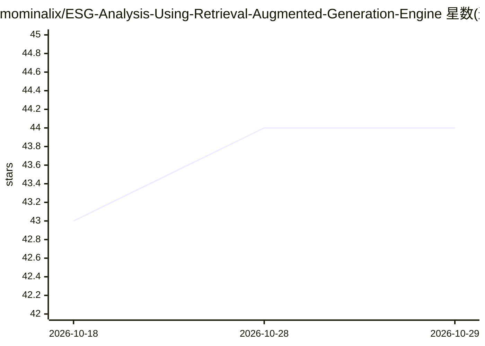

# mominalix/ESG-Analysis-Using-Retrieval-Augmented-Generation-Engine

⭐ 44 · Python · 推送 2026-09-02 · [GitHub](https://github.com/mominalix/ESG-Analysis-Using-Retrieval-Augmented-Generation-Engine) · 个人维护

**面向 ESG 文档的证据溯源 RAG 应用：检索、引用核查与报告生成**

ESG Evidence Studio 是一个证据落地的 RAG 应用：FastAPI 后端 + Streamlit 工作台，支持上传 ESG 文档、语义检索、检查引用并生成可溯源报告。默认零基础设施的内存检索模式，可选 Chroma 或 Qdrant 向量库；生成式回答需配置 OpenAI 或 Anthropic API key。提供 Docker Compose 部署、基于分类 JSON 扩展 ESG 框架、LLM/向量库提供方的懒加载注册机制；README 声明仓库当前不含开源许可证，分析结果仅为决策支持而非法律意见。

## 筛选速览

| 维度 | 判定 | 备注 |
|---|---|---|
| AI 角色 | `ai-native` | 本体是模型或模型工具 |
| 许可风险 | `none` | — |
| 部署形态 | `self-host` | docker 或自建部署 |
| 模型依赖 | — | README 未给出锁定关系 |
| 硬件要求 | — | 无带数字的原话,不猜 |
| 安装摩擦 | `low` | 无编译、无系统依赖或容器化 |
| 成熟度 | — | 结构信号不足 |

## 能力要点

- 默认内存检索模式，无需 Docker 或 API key 即可上传与搜索
- 可选 Chroma/Qdrant 向量库与 OpenAI/Anthropic LLM 提供方
- 引用核查与带认证的溯源报告生成（ADMIN_TOKEN 保护）
- 通过 config/esg_taxonomy.json 无需改代码即可扩展 ESG 框架

## 适用场景

- 上传企业 ESG 政策文档并做证据落地的检索问答
- 核查 ESG 回答的引用出处并生成可溯源报告
- 在零基础设施环境下快速演示或本地评估 ESG 知识检索

## 场景标签

`RAG` `文档问答` · 领域:知识与检索

## 证据(README 行号)

> L3: An evidence-grounded Retrieval-Augmented Generation (RAG) application for searching ESG documents, inspecting citati
> L38: The default `VECTOR_STORE_TYPE=memory` requires no infrastructure. Add `OPENAI_API_KEY` or `ANTHROPIC_API_KEY` to e

## 星数曲线

2026-10-18 43 → 2026-10-29 44（+1）

---
*卡片 v1 · prompt 1.4 · 生成 2026-10-25 · 置信度 mid · 依据 README sha `6132797d7832` · [字段定义](../../DATASET.md)*
