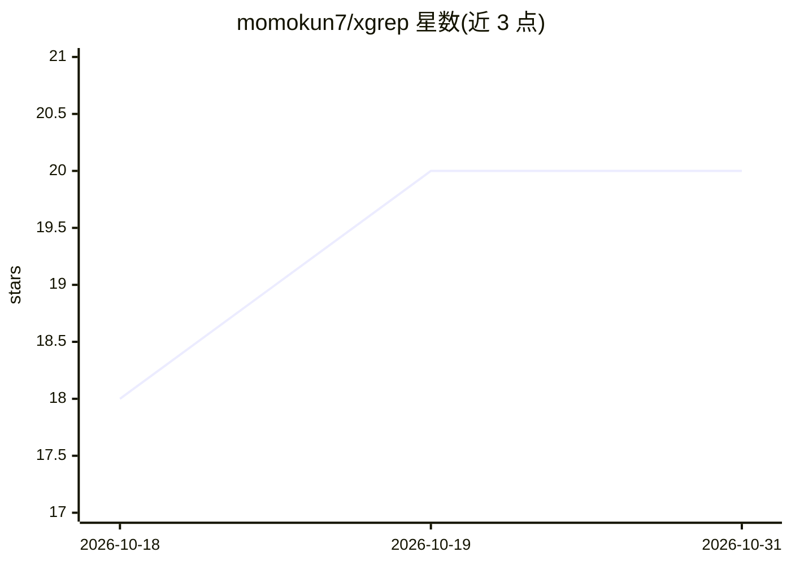

# momokun7/xgrep

⭐ 20 · Rust · Apache-2.0 · 推送 2026-10-27 · [GitHub](https://github.com/momokun7/xgrep) · [官网](https://crates.io/crates/xgrep-search) · 个人维护

**带 MCP 服务器的索引式代码搜索引擎，供人类与 AI agent 使用**

Rust 编写的命令行代码搜索工具 xg：首次搜索时自动构建 trigram 倒排索引，重复搜索时命中索引实现毫秒级响应；另提供 --find 文件查找、tree-sitter 语法感知（outline/定义/引用/repo map，覆盖 7 种语言）、git 集成（--changed/--in-diff/--log）与面向 LLM 的 Markdown 输出格式。内置 MCP 服务器（xg serve），向 Claude Code、Cursor 等 AI 编码工具暴露 search、find_references、repo_map 等工具，带分页、token 预算与会话去重。已知限制：单字符查询绕过索引、默认跳过 >10MB 与二进制文件、广泛分布的模式下索引收益下降。通过 cargo/npm/pip 或预编译二进制安装。

## 筛选速览

| 维度 | 判定 | 备注 |
|---|---|---|
| AI 角色 | `ai-enhanced` | 去掉 AI 部分产品仍成立 |
| 许可风险 | `permissive` | Apache-2.0 |
| 部署形态 | `desktop` | 安装包/桌面程序 |
| 模型依赖 | — | README 未给出锁定关系 |
| 硬件要求 | — | 无带数字的原话,不猜 |
| 安装摩擦 | `medium` | 含编译或系统依赖之一 |
| 成熟度 | — | 结构信号不足 |

## 能力要点

- trigram 倒排索引，重复搜索在实测中达毫秒级响应
- 内置 MCP 服务器（xg serve），提供 search/outline/repo_map 等 10 个工具
- tree-sitter 语法感知：定义、引用、代码块展开（Rust/Python/JS/TS/Go/Java/C/C++/Ruby）
- LLM 优化输出：语言标签、上下文行、token 感知截断

## 适用场景

- 在大型代码库上反复搜索时用索引加速定位代码
- 为 Claude Code / Cursor 等 AI 编码工具接入快速代码搜索
- 查找文件、定义与引用，生成代码库结构图

## 场景标签

`语义搜索` · 领域:知识与检索

## 证据(README 行号)

> L8: Ultra-fast indexed code search engine with MCP server for AI coding tools.
> L16: - **MCP server** — built-in Model Context Protocol server for AI coding tools (Claude Code, Cursor, etc.)
> L95: xgrep runs as an MCP server, giving AI coding tools fast indexed search.

## 星数曲线

2026-10-18 18 → 2026-10-31 20（+2）

---
*卡片 v1 · prompt 1.4 · 生成 2026-10-28 · 置信度 high · 依据 README sha `395e358686cb` · [字段定义](../../DATASET.md)*
