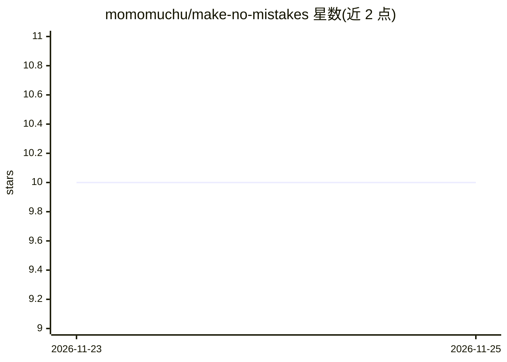

# momomuchu/make-no-mistakes

⭐ 10 · Shell · MIT · 推送 2026-07-05 · [GitHub](https://github.com/momomuchu/make-no-mistakes) · 个人维护

**让 AI 编码 agent 用可验证门禁证明工作完成的技能包**

一个安装到编码 agent 上的验证 harness 技能：先把目标固化为冻结规格，再按从便宜到昂贵的门禁栈（格式、lint、类型、测试、回归、变异测试、安全）执行-验证-修复循环；测试文件带篡改哈希检测，DONE 必须由独立上下文的 verifier 确认，作弊或篡改会以 GAMING-DETECTED 等六种终止状态硬阻断并阻止提交。面向使用 Claude Code、Codex、OpenCode 等支持 Agent Skills 标准运行时的开发者。强制钩子按运行时适配，文档说明对 Claude Code 适配最深。

## 筛选速览

| 维度 | 判定 | 备注 |
|---|---|---|
| AI 角色 | `ai-ecosystem` | LLM/agent 周边工具 |
| 许可风险 | `permissive` | MIT |
| 部署形态 | `None` |  |
| 模型依赖 | — | README 未给出锁定关系 |
| 硬件要求 | — | 无带数字的原话,不猜 |
| 安装摩擦 | `low` | 无编译、无系统依赖或容器化 |
| 成熟度 | `idea` | |

## 能力要点

- 冻结规格 + 篡改检测测试 + 独立盲 verifier 的三层验证机制
- 六种终止状态（含 GAMING-DETECTED、INTEGRITY-COMPROMISED），失败即硬阻断
- ed25519 签名清单作为信任根，OS 级 git-hook 兜底
- v0.13.0 版本自述含 494 个单元测试、约 98% 覆盖率的自评测套件

## 适用场景

- 给 Claude Code / Codex 加一层防作弊的任务完成验证
- 在提交前自动检测测试被削弱或规格被篡改
- 多 agent 分工流程中引入独立性守卫避免共识陷阱

## 场景标签

`编码 Agent` `代码审查` · 领域:编码与开发

## 证据(README 行号)

> L21: `/make-no-mistakes` is one skill — for Claude Code, Codex, OpenCode, or any agent speaking the open Agent Skills st
> L48: **2. Loop.** Execute → verify → fix, against a stack of gates ordered cheap-to-expensive: format, lint, types, test
> L116: **Any coding agent** that speaks the open Agent Skills standard — Claude Code, Codex CLI, OpenCode, and the ~40 ru

## 星数曲线

2026-11-23 10 → 2026-11-25 10（+0）

---
*卡片 v1 · prompt 1.4 · 生成 2026-11-23 · 置信度 high · 依据 README sha `9fdbe0b70f8d` · [字段定义](../../DATASET.md)*
