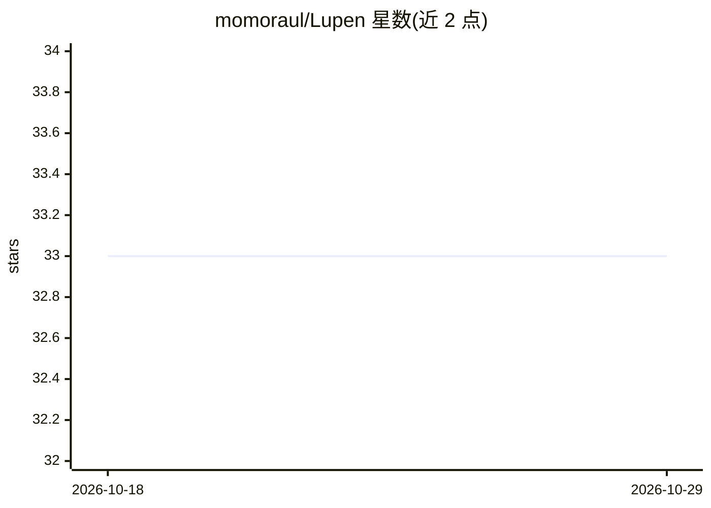

# momoraul/Lupen

⭐ 33 · Swift · MIT · 推送 2026-09-13 · [GitHub](https://github.com/momoraul/Lupen) · 个人维护

**给 Claude Code/Codex 会话做逐轮成本核算的 macOS 菜单栏应用**

面向 macOS（26+，Apple Silicon）的菜单栏应用与 CLI，读取本地的 Claude Code 与 Codex 会话 JSONL 日志，按 Turn、Step、SkillGroup、SubAgent 逐层重算成本：用原始 token 与公开价格表重定价，并与官方报告总额做差异核对。支持全文搜索并恢复会话、附件来源标记、5 小时限额的贝叶斯估计，以及输出 JSON/CSV 与 verify/budget 退出码门禁供 CI 使用。零网络请求，数据不离开本机。通过 Homebrew cask 或签名 DMG 安装，也可从源码构建。

## 筛选速览

| 维度 | 判定 | 备注 |
|---|---|---|
| AI 角色 | `ai-ecosystem` | LLM/agent 周边工具 |
| 许可风险 | `permissive` | MIT |
| 部署形态 | `None` |  |
| 模型依赖 | — | README 未给出锁定关系 |
| 硬件要求 | — | 无带数字的原话,不猜 |
| 安装摩擦 | `medium` | 含编译或系统依赖之一 |
| 成熟度 | — | 结构信号不足 |

## 能力要点

- 从原始 token 重算每轮成本并与官方报告总额 diff 核对
- 成本按 Turn/Step/SkillGroup/SubAgent 逐层归因，子代理费用可回卷父轮
- 全文搜索会话并经 `claude --resume` / `codex resume` 恢复
- 同一二进制兼作 `lupen` CLI，verify/budget 提供 CI 退出码门禁
- 零网络请求，仅读取本地会话文件

## 适用场景

- 想知道今天 AI 编码花的钱具体落在哪个会话、哪一轮、哪个子代理
- 在 CI 或提交钩子中用 verify/budget 门禁拦截超支或成本漂移
- 以 JSON/CSV 导出按项目、技能、模型维度的花费报表

## 场景标签

`LLM 可观测性` · 领域:评测与运维

## 证据(README 行号)

> L5:  Lupen recomputes your spend straight from the raw Claude Code and Codex logs — broken down by turn, step, and sub-a
> L46: - **Cost drift verification** — Run the **Verify Usage** window to recompute every cost from raw tokens and the pub
> L54: - **Zero network** — Lupen only reads local Claude Code and Codex files on disk. No API keys, no telemetry, no clou

## 星数曲线

2026-10-18 33 → 2026-10-29 33（+0）

---
*卡片 v1 · prompt 1.4 · 生成 2026-10-25 · 置信度 high · 依据 README sha `1850ebcac3a5` · [字段定义](../../DATASET.md)*
