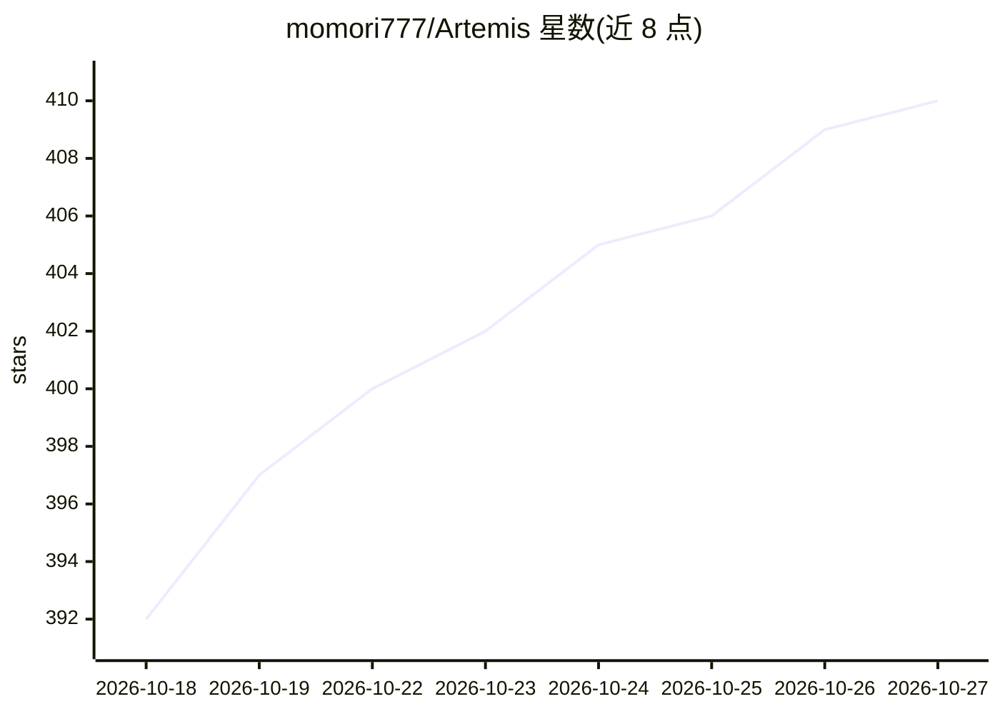

# momori777/Artemis

⭐ 410 · Python · NOASSERTION · 推送 2026-10-25 · [GitHub](https://github.com/momori777/Artemis) · 个人维护 · 中文 README

**全本地多角色 AI 女友系统：聊天+语音+画图+Live2D 桌宠**

面向终端用户的全离线 AI 女友应用：以 OpenClaw 为 Agent 框架，接入 llama.cpp 本地 LLM、GPT-SoVITS 语音合成、Faster-Whisper 语音识别、ComfyUI 图像生成，并通过 Live2D 与 PySide6 桌宠呈现角色。支持多角色热切换且记忆按角色隔离，可导入 SillyTavern 角色卡与聊天记录，通过 QQ/Telegram Bot 或本地 Web 前端交互。长期记忆使用 mem0 + Qdrant 向量库与 BM25 混合检索，内置行为引擎维护关系分数。默认面向 NVIDIA GPU，通过 PowerShell/Bash 脚本克隆依赖仓库并下载模型，AMD 用户需使用 AMD_GPU 目录脚本。

## 筛选速览

| 维度 | 判定 | 备注 |
|---|---|---|
| AI 角色 | `ai-native` | 本体是模型或模型工具 |
| 许可风险 | `none` | NOASSERTION |
| 部署形态 | `desktop` | 安装包/桌面程序 |
| 模型依赖 | local-ok | 支持本地模型 |
| 硬件要求 | `gpu-8g` | |
| 安装摩擦 | `low` | 无编译、无系统依赖或容器化 |
| 成熟度 | — | 结构信号不足 |

## 能力要点

- 多角色热切换，SOUL/IDENTITY/TTS 权重/Live2D 模型自动切换且记忆隔离
- SillyTavern PNG/JSON 角色卡与 JSONL 聊天记录导入
- 本地 GPT-SoVITS TTS、Faster-Whisper ASR（约 1.5GB 显存）、ComfyUI 图像生成
- 显存智能分层：≥12GB 全在线、8GB 热切换、<8GB 安全模式
- mem0 + Qdrant 向量与 BM25 混合检索的长期记忆系统

## 适用场景

- 在自有硬件上运行全离线、无审查的 AI 陪伴角色
- 通过 QQ/Telegram 或本地网页与 AI 女友文字/语音对话并生成角色图像
- 导入已有 SillyTavern 角色卡和聊天记录延续角色扮演
- 以 Live2D/桌宠形式在桌面获得带情感表达的角色陪伴

## 场景标签

`聊天机器人` `语音合成` `图像生成` · 领域:对话与助手

## 证据(README 行号)

> L13: An uncensored AI girlfriend harem project powered by OpenClaw + QQ Bot + Telegram Bot + llama.cpp + GPT-SoVITS + Co
> L8: > All conversations, voice, images, and character animations are generated on your own machine. No cloud servers, no
> L184: - 🔄 **Multi-Character Hot-Swap** - One-click switch between AI girlfriends (Natsume ⇄ ATRI ⇄ Sakura); SOUL/IDENTIT

## 星数曲线

2026-10-18 392 → 2026-10-27 410（+18）

---
*卡片 v1 · prompt 1.4 · 生成 2026-10-22 · 置信度 mid · 依据 README sha `fdddc22cc856` · [字段定义](../../DATASET.md)*
