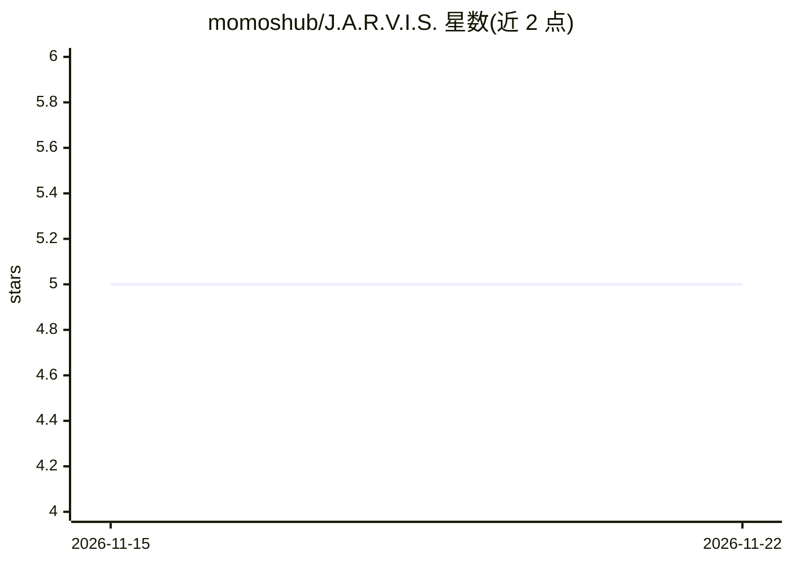

# momoshub/J.A.R.V.I.S.

⭐ 5 · TypeScript · Apache-2.0 · 推送 2026-11-20 · [GitHub](https://github.com/momoshub/J.A.R.V.I.S.) · [官网](https://thediligentengineer.com/J.A.R.V.I.S) · 个人维护

**围绕 Claude Code 的会话与运维 harness，经 Slack 对话**

一个包裹 Claude Code CLI 或 Anthropic API 的"harness of harnesses"：管理会话、记忆、角色与工具沙箱，调度任务、等待 CI 与 reviewer、运行后台 worker，并能修改和重新部署自身源码。Slack 为主要交互前端，附带工具调用时间线的流式回复与管理面板。以 Bun + TypeScript 实现，记忆存于 bun:sqlite，角色分级控制工具权限（仅 owner 获得权限绕过，其余角色沙箱化）。macOS 优先开发，Linux 支持除桌面控制外的功能。

## 筛选速览

| 维度 | 判定 | 备注 |
|---|---|---|
| AI 角色 | `ai-ecosystem` | LLM/agent 周边工具 |
| 许可风险 | `permissive` | Apache-2.0 |
| 部署形态 | `None` |  |
| 模型依赖 | locked-api |  |
| 硬件要求 | — | 无带数字的原话,不猜 |
| 安装摩擦 | `low` | 无编译、无系统依赖或容器化 |
| 成熟度 | `idea` | |

## 能力要点

- 会话、记忆、角色与工具沙箱的统一管理 harness
- 可修改并重新部署自身源码（self-updating）
- owner 全权限、其余角色只读工具白名单沙箱
- Bun + TypeScript + bun:sqlite，含 React 管理面板

## 适用场景

- 通过 Slack 让 AI 助手调度开发任务并跟进 CI/review
- 搭建可长期驻留、带记忆与角色的个人 agent 运维助手
- 让 agent 以受控沙箱权限处理团队消息与 PR

## 场景标签

`编码 Agent` `AI 助手` · 领域:编码与开发

## 证据(README 行号)

> L14: Jarvis is a harness of harnesses. Claude Code is already a harness around a model; Jarvis is the harness around Cla
> L57: - **brain**: local **Claude Code CLI** (default, full tool access) or the **@anthropic-ai/sdk** API

## 星数曲线

2026-11-15 5 → 2026-11-22 5（+0）

---
*卡片 v1 · prompt 1.4 · 生成 2026-11-21 · 置信度 high · 依据 README sha `4b561ee39fda` · [字段定义](../../DATASET.md)*
