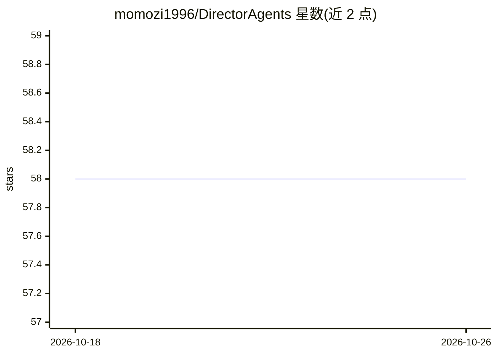

# momozi1996/DirectorAgents

⭐ 58 · Shell · MIT · 推送 2026-05-11 · [GitHub](https://github.com/momozi1996/DirectorAgents) · 个人维护 · 中文 README

**31位导演风格的多Agent创意协作技能包**

面向 OpenClaw/StepClaw 智能体框架的技能包（SKILL.md 格式）：将31位导演（华语15、好莱坞8、欧洲与亚洲艺术导演）的风格思想、视觉语言与叙事手法整理为可调用的独立 Skill，通过顺序链、辩论投票、主席团/专家混合三种多智能体协作模式，为剧本创作、影像风格设计、叙事结构优化提供创意输出。支持触发词调用、单独调用某位导演视角及脚本自动匹配导演。安装方式为复制到 skills 目录或 git clone。

## 筛选速览

| 维度 | 判定 | 备注 |
|---|---|---|
| AI 角色 | `ai-native` | 本体是模型或模型工具 |
| 许可风险 | `permissive` | MIT |
| 部署形态 | `None` |  |
| 模型依赖 | — | README 未给出锁定关系 |
| 硬件要求 | — | 无带数字的原话,不猜 |
| 安装摩擦 | `low` | 无编译、无系统依赖或容器化 |
| 成熟度 | — | 结构信号不足 |

## 能力要点

- 31位导演各自有独立 Skill 文件，可单独调用
- 三种协作模式：顺序链、辩论投票、主席团/专家混合（MoA）
- 覆盖剧本创作、影像风格设计、叙事结构优化、短剧与广告创意场景
- 提供导演匹配脚本与触发词调用方式

## 适用场景

- 剧本创作时获得多导演风格的创意建议
- 为独立电影做视觉风格定位（色彩、镜头、光影）
- 短剧与广告创意的方案比选与融合

## 场景标签

`多智能体` `AI 写作` · 领域:Agent 开发

## 证据(README 行号)

> L11: **DirectorAgents导演智囊团**是一个基于多智能体（Multi-Agent）框架的创意协作系统，整合了31位世界著名导演的风格思想、视觉语言和叙事手法。通过顺序链、辩论投票、主席团三种协作模式，为剧本创作、影像设计和
> L169: ├── SKILL.md                     # 主技能文件（OpenClaw/StepClaw）
> L264: - Skill文件格式：遵循OpenClaw/StepClaw SKILL.md规范

## 星数曲线

2026-10-18 58 → 2026-10-26 58（+0）

---
*卡片 v1 · prompt 1.4 · 生成 2026-10-24 · 置信度 high · 依据 README sha `a94b04361adc` · [字段定义](../../DATASET.md)*
